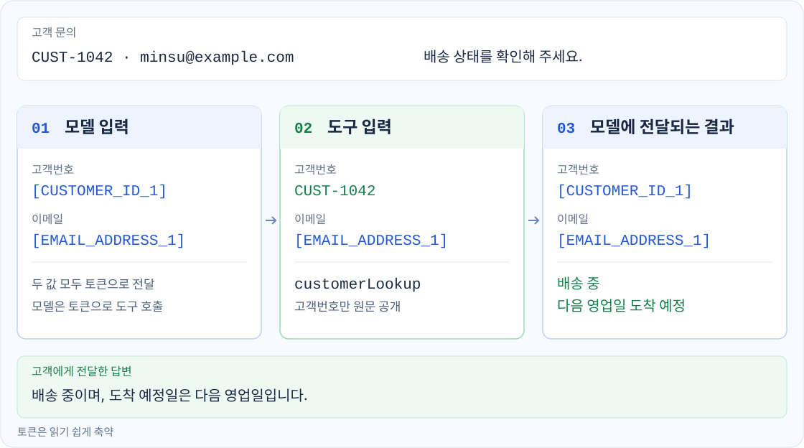
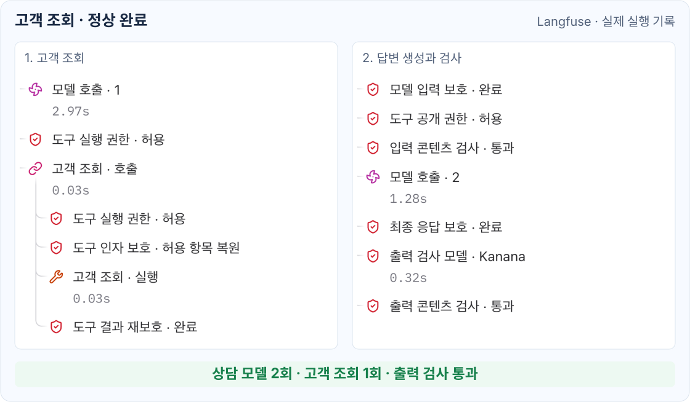
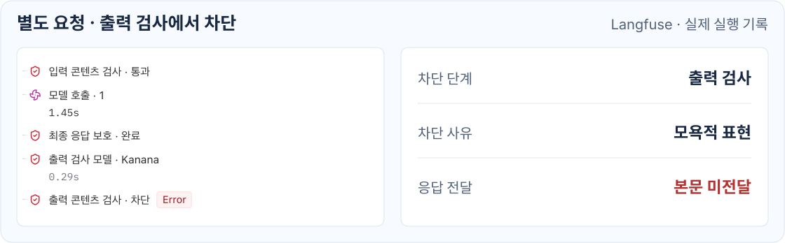
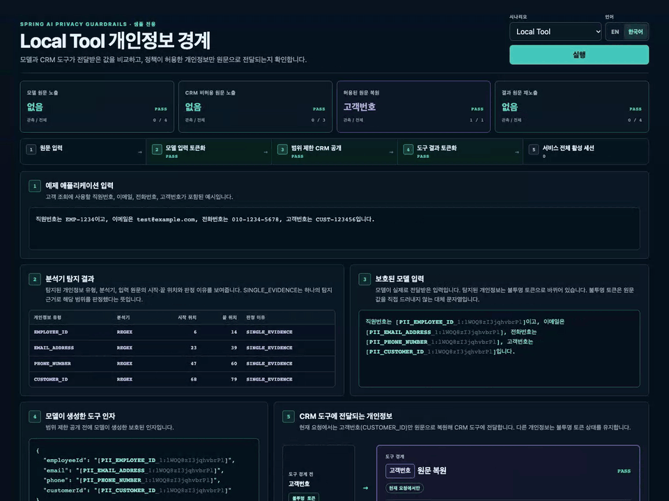

# Spring AI Privacy Guardrails

[](https://central.sonatype.com/artifact/io.github.ultramancode/spring-ai-privacy-guardrails-chat-client-spring-boot-starter)
[](https://github.com/ultramancode/spring-ai-privacy-guardrails/actions/workflows/ci.yml)
[](LICENSE)

[English](README.md) | [한국어](README.ko.md) | [문서](https://ultramancode.github.io/spring-ai-privacy-guardrails/ko/)

<!-- i18n-source: README.md -->
<!-- i18n-source-sha256: 75bc936f404d7f8c3b7c9a06aa7ff4d289f80f35dccb2ebadac4cfdeb9fd5301 -->

**애플리케이션에 개인정보 보호, 도구 권한 제어, 콘텐츠 검사를 적용합니다.**

탐지된 개인정보는 모델에 전달하기 전에 토큰화하고, 도구에는 필요한 원문만 공개합니다. 도구 결과는 다시 보호합니다.

<br>

<p align="center">
  <a href="https://www.youtube.com/watch?v=AqlubcLOtSc"></a>
</p>

<p align="center">
  <strong>데모 영상 (YouTube):</strong>
  <a href="https://www.youtube.com/watch?v=AqlubcLOtSc">한국어</a> ·
  <a href="https://www.youtube.com/watch?v=gu5pPaA-NQc&amp;t=5s">English</a>
</p>

## 외부 소개

- [Spring 공식 블로그 — This Week in Spring](https://spring.io/blog/2026/08/18/this-week-in-spring-august-18-2026/)
- [Awesome Spring AI](https://github.com/spring-ai-community/awesome-spring-ai#extensions-and-forks)

## 개인정보 보호 동작 예시

[](docs/images/customer-lookup-ko.svg)

고객이 고객번호와 이메일로 배송 상태를 문의합니다.
모델은 토큰으로 고객 조회 도구(`customerLookup`)를 호출합니다. 도구에는 고객번호만 원문으로 전달하고 이메일은 토큰으로 유지합니다.
조회 결과의 개인정보는 다시 보호한 뒤 모델이 답변하도록 합니다.

이 예시는 고객번호를 탐지하는 사용자 정의 규칙과 도구별 원문 공개 정책을 사용합니다.

## 세 가지 핵심 기능

세 기능은 독립적으로 선택하거나 함께 사용할 수 있습니다.

| 원하는 동작 | 사용할 기능 |
| --- | --- |
| 모델에는 탐지된 개인정보를 감추고 도구별로 원문 공개 범위를 지정 | [Privacy](https://ultramancode.github.io/spring-ai-privacy-guardrails/ko/privacy/) |
| 현재 사용자의 권한에 따라 모델에 공개할 도구와 실행할 도구를 제한 | [Tool Authorization](https://ultramancode.github.io/spring-ai-privacy-guardrails/ko/security/) |
| 규칙·로컬 ONNX·HTTP 검사 모델로 요청과 응답을 점검 | [Content Inspection](https://ultramancode.github.io/spring-ai-privacy-guardrails/ko/inspection/) |

## 실제 실행과 차단 기록

아래는 별도 고객 조회 요청의 실행 기록입니다.
두 번의 상담 모델 호출 사이에 고객 조회가 한 번 실행되고, 최종 응답은 출력 검사를 통과했습니다.
앱에서 모델 호출·도구 실행과 가드레일 판정을 Langfuse에 기록했습니다.

[](docs/images/runtime-trace-ko.svg)

### 출력 검사로 차단된 응답

출력 검사에서 답변의 모욕적인 표현을 감지해 응답 전달을 차단했습니다.

[](docs/images/runtime-blocked-trace-ko.svg)

## 애플리케이션에 적용

이메일 토큰화부터 시작하는 최소 구성입니다.

Java 17 이상, Spring AI 2.0.0 이상, Spring Boot 4.0.0 이상을 사용합니다.
[저장소 설정과 Maven 안내](https://ultramancode.github.io/spring-ai-privacy-guardrails/ko/getting-started/#add-the-client-starter)를 확인하세요.

클라이언트 스타터를 추가합니다.

```gradle
dependencies {
    implementation "io.github.ultramancode:spring-ai-privacy-guardrails-chat-client-spring-boot-starter:0.4.0"
}
```

이 개인정보 보호 예제에서는 이메일을 탐지하도록 `COMMON` 프리셋을 활성화합니다.
`src/main/resources/application.yml`에 다음 설정을 추가합니다.

```yaml
spring:
  ai:
    privacy:
      rules:
        enabled: true
        presets: [COMMON]
```

애플리케이션의 `@Configuration` 클래스에서 `GuardrailsChatClientFactory`로 클라이언트를 생성합니다.
정책에서 개인정보 보호를 선택합니다.

```java
@Bean
ChatClient chatClient(ChatModel chatModel, GuardrailsChatClientFactory guardrailsChatClientFactory) {
    GuardrailsPolicy policy = GuardrailsPolicy.builder()
            .privacy()
            .build();
    return guardrailsChatClientFactory.builder(chatModel, policy)
            .build();
}
```

서비스에서 이 빈을 주입받아 호출합니다.

```java
String response = chatClient.prompt()
        .user("Contact alice@example.com.")
        .call()
        .content();
```

모델에는 이메일 원문 대신 대체 토큰이 전달됩니다.
아래 예제에서는 설명을 위해 생성된 토큰을 `[EMAIL_TOKEN]`으로 표시합니다.

```text
Contact [EMAIL_TOKEN].
```

각 기능의 설정과 조합 방법은 [시작하기](https://ultramancode.github.io/spring-ai-privacy-guardrails/ko/getting-started/)를 참고하세요.

## 세 가지 기능 함께 사용하기

다음은 개인정보 보호, Spring Security 기반 도구 권한, 콘텐츠 검사를 함께 사용하는 고객 조회 예제입니다.
콘텐츠 검사를 통과한 요청에서도 조회 도구의 실행 권한을 별도로 확인합니다.

아래 예제에서는 위의 `COMMON` 프리셋과 [Security 스타터](https://ultramancode.github.io/spring-ai-privacy-guardrails/ko/security/#spring-boot-스타터-추가),
설정된 [검사기](https://ultramancode.github.io/spring-ai-privacy-guardrails/ko/getting-started/#content-inspection)를 함께 사용합니다.
이메일로 고객을 조회하는 `customerLookup` 도구가 `customerLookupToolCallback`이라는 `ToolCallback` 빈으로 등록되어 있다고 가정합니다.
이 구성은 앞의 `chatClient` 빈을 대체하며, 관리자만 도구를 사용할 수 있도록 권한 정책을 함께 정의합니다.

```java
@Bean
AuthorizationManager<ToolAuthorizationContext> toolAuthorizationManager() {
    return AuthorityAuthorizationManager.hasRole("ADMIN");
}

@Bean
ChatClient chatClient(ChatModel chatModel, GuardrailsChatClientFactory guardrailsChatClientFactory,
        ToolCallback customerLookupToolCallback) {
    // 원문 공개(Disclosure): customerLookup 도구에 이메일 원문만 전달
    ToolDisclosurePolicy toolDisclosurePolicy = ToolDisclosurePolicy.allowEntityTypesByToolName(
            Map.of("customerLookup", List.of("EMAIL_ADDRESS")));
    GuardrailsPolicy.Privacy privacySettings = GuardrailsPolicy.Privacy.builder()
            .toolDisclosurePolicy(toolDisclosurePolicy)
            .build();
    GuardrailsPolicy policy = GuardrailsPolicy.builder()
            .privacy(privacySettings)   // Privacy: 탐지된 개인정보 토큰화
            .toolAuthorization(true)   // Security: Spring Security로 ADMIN 역할 확인
            .inspection()              // Inspection: 프롬프트 인젝션·프롬프트 누출·유해 표현 등 검사
            .build();
    return guardrailsChatClientFactory.builder(chatModel, policy)
            .defaultTools(customerLookupToolCallback)
            .build();
}
```

권한 정책은 현재 사용자의 `ADMIN` 역할을 확인합니다.
원문 공개 맵은 등록한 도구 이름을 키로, 원문 공개를 허용할 개인정보 유형 목록을 값으로 사용합니다.
콘텐츠 검사 항목은 선택한 검사기와 설정에 따라 달라집니다.

인증된 요청에서 이 클라이언트를 호출합니다.

```java
String response = chatClient.prompt()
        .user("Look up the customer with email alice@example.com.")
        .call()
        .content();
```

검사기에는 이메일이 `[EMAIL_TOKEN]`으로 바뀐 요청이 전달됩니다.
검사 결과가 `BLOCK`이면 업무 모델을 호출하지 않습니다. `ALLOW`이면 같은 보호된 요청을 모델에 전달하고,
도구 사용 권한은 별도로 확인합니다.

- **관리자(`ADMIN`):** 모델이 `customerLookup`을 요청할 수 있습니다. 실행 직전에 권한을 다시 확인하고,
  도구에 전달할 `alice@example.com` 원문을 복원합니다. 다른 개인정보 유형은 토큰으로 유지합니다.
- **일반 사용자(`ADMIN` 역할 없음):** 모델에 `customerLookup`을 공개하지 않습니다.
  모델이 이름을 지정해 호출하더라도 도구를 실행하지 않고 이메일 원문도 복원하지 않습니다.

조회 결과를 모델에 다시 보내기 전에도 탐지된 개인정보를 토큰화하고, 보호된 내용을 다시 검사합니다.
이 검사에서 `BLOCK`이면 다음 모델 호출 전에 중단합니다.

[도구 등록과 MCP 연동](https://ultramancode.github.io/spring-ai-privacy-guardrails/ko/privacy/#도구별-원문-공개)을 참고하세요.
사용자 정의 공개 로직은 [별도 정책 클래스](https://ultramancode.github.io/spring-ai-privacy-guardrails/ko/privacy/#custom-tool-disclosure-policy)로 구현할 수 있습니다.
최종 응답 보호와 출력 검사는 [출력 정책](https://ultramancode.github.io/spring-ai-privacy-guardrails/ko/configuration/#기능과-출력-정책-조합)에서 별도로 선택합니다.

## 필요한 기능 추가

| 목적 | 다음 단계 |
| --- | --- |
| 사번·고객번호 등 자체 식별자 탐지 | [Java 규칙과 프리셋](https://ultramancode.github.io/spring-ai-privacy-guardrails/ko/privacy/#로컬-규칙과-프리셋) |
| 더 넓은 탐지 범위 또는 NER 모델 사용 | [Presidio·OpenNLP 선택](https://ultramancode.github.io/spring-ai-privacy-guardrails/ko/privacy/#choose-an-analyzer) |
| 사용자별 도구 공개·실행 권한 | [Spring Security 최소 설정](https://ultramancode.github.io/spring-ai-privacy-guardrails/ko/security/#spring-boot-스타터-추가) |
| 입력 검사와 선택적 출력 검사 | [콘텐츠 검사 최소 설정](https://ultramancode.github.io/spring-ai-privacy-guardrails/ko/inspection/#입력-검사-설정) |
| 최종 응답의 개인정보 토큰화·마스킹·차단 | [출력 보호](https://ultramancode.github.io/spring-ai-privacy-guardrails/ko/privacy/#출력-정책과-스트리밍) |
| 예상과 다른 동작 진단 | [문제 해결](https://ultramancode.github.io/spring-ai-privacy-guardrails/ko/troubleshooting/) |

## 샘플

샘플 애플리케이션은 고정된 예제로 Local Tool, RAG, MCP, Security, Inspection의 동작을 보여줍니다.
화면과 실행 방법은 [샘플 가이드](https://ultramancode.github.io/spring-ai-privacy-guardrails/ko/sample/)를 참고하세요.

<p align="center">
  <a href="docs/images/privacy-boundary-inspector-demo-ko.gif"></a>
</p>

<p align="center">
  <strong>Inspector 데모 영상:</strong>
  <a href="https://youtu.be/vir-x78e9j8">한국어</a> ·
  <a href="https://youtu.be/IeeA5ogIX_I">English</a>
</p>

## 호환성

| 구성 요소 | 최소 지원 버전 |
| --- | --- |
| Java | 17 |
| Spring AI | 2.0.0 |
| Spring Boot | 4.0.0 |
| Spring Security | 7.0.0 |

Java, Spring AI, Spring Boot, Spring Security의 새 버전이 출시되면
호환성을 지속적으로 검증하고 지원합니다.
Boot 스타터의 Spring Security 버전은 Spring Boot BOM이 선택합니다.

## 상세 문서

- [시작하기](https://ultramancode.github.io/spring-ai-privacy-guardrails/ko/getting-started/): 공통 설정과 개인정보 보호·도구 권한·콘텐츠 검사 시작 안내
- [설정](https://ultramancode.github.io/spring-ai-privacy-guardrails/ko/configuration/): 의존성, 클라이언트 생성과 정책 재사용
- [개인정보 보호](https://ultramancode.github.io/spring-ai-privacy-guardrails/ko/privacy/): 분석기, 토큰화, 도구 원문 공개, 출력 보호와 처리 한도
- [Spring Security 도구 권한](https://ultramancode.github.io/spring-ai-privacy-guardrails/ko/security/): 도구 권한 정책, 고급 도구
  구성, Tool Search와 보안 컨텍스트 전달
- [콘텐츠 검사](https://ultramancode.github.io/spring-ai-privacy-guardrails/ko/inspection/): 선택적 규칙, 로컬 ONNX 분류 모델과 HTTP 검사 모델
- [런타임 관측](docs/ko/observability.md): 정상·차단 실행 기록과 Observer 사용법
- [아키텍처](https://ultramancode.github.io/spring-ai-privacy-guardrails/ko/architecture/): 모듈과 모델·도구·세션 실행 흐름
- [위협 모델](https://ultramancode.github.io/spring-ai-privacy-guardrails/ko/threat-model/): 보호 대상, 신뢰 경계, 통제, 한계와 별도 관리 영역
- [평가와 벤치마크](https://ultramancode.github.io/spring-ai-privacy-guardrails/ko/evaluation/): 검증 항목과 해석 범위
- [샘플 가이드](https://ultramancode.github.io/spring-ai-privacy-guardrails/ko/sample/): Inspector 시나리오, 런타임 엔드포인트와 각
  화면의 검증 근거
- [전체 샘플 가이드](samples/spring-ai-demo/README.ko.md): 선택적 분석기와 실제 모델 연동
  예제

## 빌드와 검증

```bash
./gradlew --no-daemon clean check
```

이 명령은 테스트를 실행하고 저장소의 모듈 규칙을 검사합니다.
번역 동기화는 `./gradlew verifyDocTranslations`로 별도 확인할 수 있습니다. 데모 분석기 회귀 테스트와
JMH 벤치마크는 [평가 문서](https://ultramancode.github.io/spring-ai-privacy-guardrails/ko/evaluation/)를 참고하세요.

## 기여하기

[기여 가이드](CONTRIBUTING.md)를 참고하세요. 모든 기여는 Apache License 2.0으로
제공됩니다.
