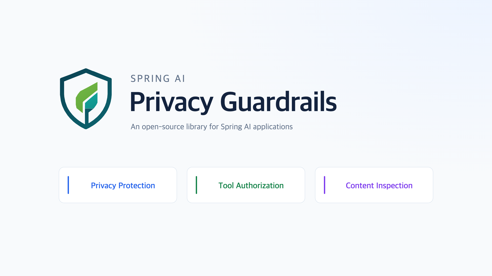
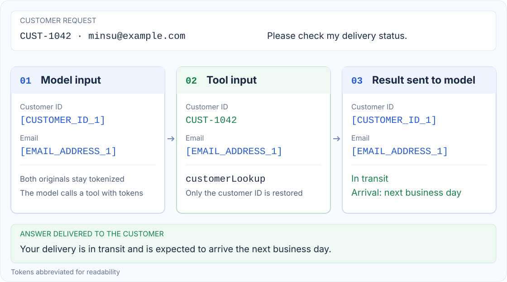
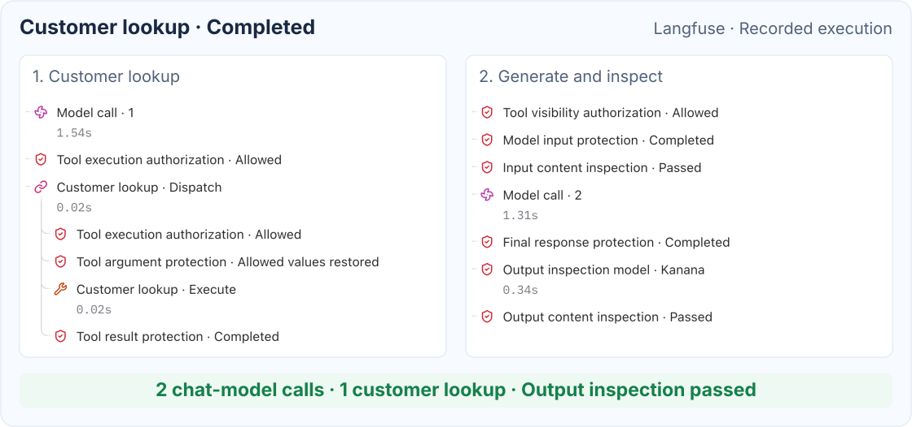
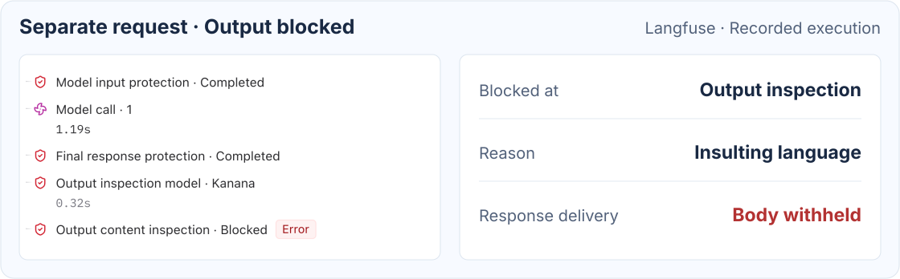
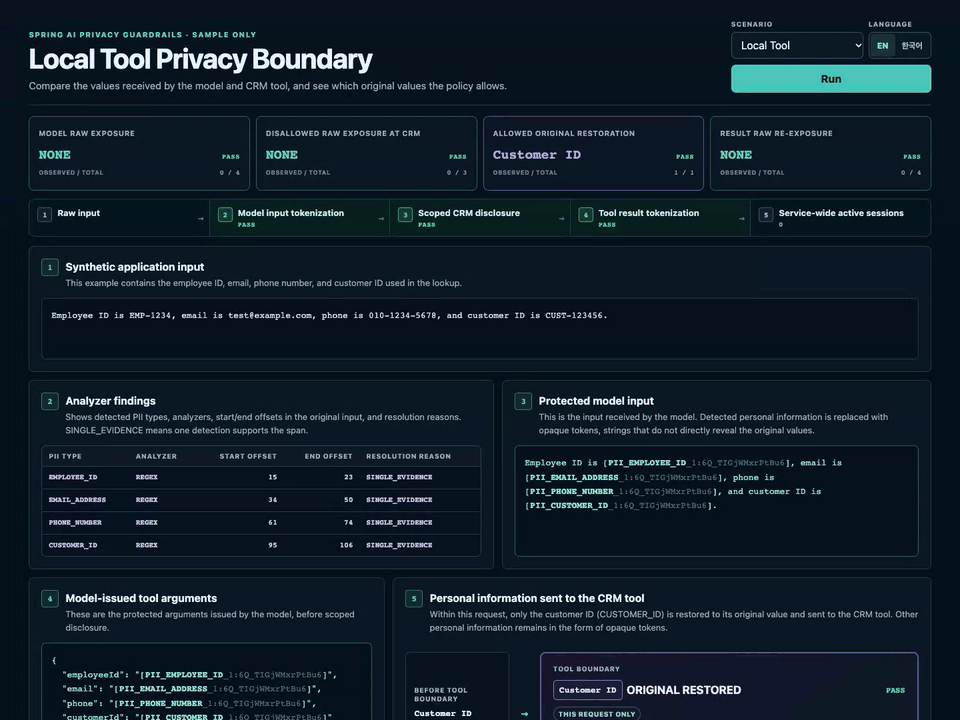

# Spring AI Privacy Guardrails

[](https://central.sonatype.com/artifact/io.github.ultramancode/spring-ai-privacy-guardrails-chat-client-spring-boot-starter)
[](https://github.com/ultramancode/spring-ai-privacy-guardrails/actions/workflows/ci.yml)
[](LICENSE)

[English](README.md) | [한국어](README.ko.md) | [Documentation](https://ultramancode.github.io/spring-ai-privacy-guardrails/)

**Apply privacy protection, tool authorization and content inspection to your application.**

Tokenize detected PII before it reaches the model. Reveal only the originals a tool needs, then protect its result again.

<br>

<p align="center">
  <a href="https://www.youtube.com/watch?v=gu5pPaA-NQc&amp;t=5s"></a>
</p>

<p align="center">
  <strong>Demo videos (YouTube):</strong>
  <a href="https://www.youtube.com/watch?v=gu5pPaA-NQc&amp;t=5s">English</a> ·
  <a href="https://www.youtube.com/watch?v=AqlubcLOtSc">한국어</a>
</p>

## Featured in

- [Spring Blog — This Week in Spring](https://spring.io/blog/2026/08/18/this-week-in-spring-august-18-2026/)
- [Awesome Spring AI](https://github.com/spring-ai-community/awesome-spring-ai#extensions-and-forks)

## Privacy Protection in Action

[](docs/images/customer-lookup.svg)

A customer asks for a delivery update with a customer ID and an email address.
The model calls the `customerLookup` tool with tokens. The tool receives the original customer ID,
while the email stays tokenized. PII in the lookup result is protected again before the model answers.

This example uses a custom customer-ID detection rule and a per-tool disclosure policy.

## Three Core Features

Use these features independently or together.

| What you need | Feature |
| --- | --- |
| Keep detected PII out of the model and allow originals only for selected tools | [Privacy](https://ultramancode.github.io/spring-ai-privacy-guardrails/privacy/) |
| Limit tool visibility and execution using the current user's permissions | [Tool Authorization](https://ultramancode.github.io/spring-ai-privacy-guardrails/security/) |
| Check requests and responses with rules, local ONNX or an HTTP guard model | [Content Inspection](https://ultramancode.github.io/spring-ai-privacy-guardrails/inspection/) |

## See What Ran — and What Was Blocked

Two conversation-model calls surround one customer lookup. The final response passes output inspection.
The application records the model calls, tool execution and guardrail decisions in Langfuse.

[](docs/images/runtime-trace.svg)

### A Response Blocked by Output Inspection

Output inspection detected insulting language in the reply and blocked its delivery.

[](docs/images/runtime-blocked-trace.svg)

## Add Protection to an Application

Start with a minimal setup for email tokenization.

Use Java 17 or later, Spring AI 2.0.0 or later and Spring Boot 4.0.0 or later.
See [repository configuration and Maven setup](https://ultramancode.github.io/spring-ai-privacy-guardrails/getting-started/#add-the-client-starter).

Add the client starter:

```gradle
dependencies {
    implementation "io.github.ultramancode:spring-ai-privacy-guardrails-chat-client-spring-boot-starter:0.4.0"
}
```

For this privacy example, enable the `COMMON` preset to detect email addresses.
Add to `src/main/resources/application.yml`:

```yaml
spring:
  ai:
    privacy:
      rules:
        enabled: true
        presets: [COMMON]
```

Create the client through `GuardrailsChatClientFactory` in an application `@Configuration` class.
Select privacy protection in its policy:

```java
@Bean
ChatClient chatClient(ChatModel chatModel, GuardrailsChatClientFactory guardrailsChatClientFactory) {
    GuardrailsPolicy policy = GuardrailsPolicy.builder()
            .privacy()
            .build();
    return guardrailsChatClientFactory.builder(chatModel, policy)
            .build();
}
```

Inject this bean into your service and call it:

```java
String response = chatClient.prompt()
        .user("Contact alice@example.com.")
        .call()
        .content();
```

The model receives a replacement token instead of the email address.
For readability, the examples below use `[EMAIL_TOKEN]` to represent the generated token:

```text
Contact [EMAIL_TOKEN].
```

See [Getting Started](https://ultramancode.github.io/spring-ai-privacy-guardrails/getting-started/) for feature setup and combinations.

## Use All Three Features Together

This customer lookup example combines privacy protection, Spring Security tool authorization and content inspection.
Passing content inspection does not grant permission to run the lookup tool.

The example below uses the `COMMON` preset above with the [Security starter](https://ultramancode.github.io/spring-ai-privacy-guardrails/security/#add-the-spring-boot-starter)
and a configured [inspector](https://ultramancode.github.io/spring-ai-privacy-guardrails/getting-started/#content-inspection).
It assumes that a `ToolCallback` bean named `customerLookupToolCallback` provides a `customerLookup` tool that looks up customers by email address.
This configuration replaces the earlier `chatClient` bean and adds an admin-only tool authorization policy:

```java
@Bean
AuthorizationManager<ToolAuthorizationContext> toolAuthorizationManager() {
    return AuthorityAuthorizationManager.hasRole("ADMIN");
}

@Bean
ChatClient chatClient(ChatModel chatModel, GuardrailsChatClientFactory guardrailsChatClientFactory,
        ToolCallback customerLookupToolCallback) {
    // Original PII disclosure: pass only original email addresses to customerLookup
    ToolDisclosurePolicy toolDisclosurePolicy = ToolDisclosurePolicy.allowEntityTypesByToolName(
            Map.of("customerLookup", List.of("EMAIL_ADDRESS")));
    GuardrailsPolicy.Privacy privacySettings = GuardrailsPolicy.Privacy.builder()
            .toolDisclosurePolicy(toolDisclosurePolicy)
            .build();
    GuardrailsPolicy policy = GuardrailsPolicy.builder()
            .privacy(privacySettings)   // Privacy: tokenize detected PII
            .toolAuthorization(true)   // Security: check the ADMIN role with Spring Security
            .inspection()              // Inspection: check for prompt injection, prompt leaking and toxic language
            .build();
    return guardrailsChatClientFactory.builder(chatModel, policy)
            .defaultTools(customerLookupToolCallback)
            .build();
}
```

The authorization policy checks the current user's `ADMIN` role.
The disclosure map uses the registered tool name as its key and the list of allowed PII entity types as its value.
The inspection checks depend on the selected inspectors and their configuration.

Call it from an authenticated request:

```java
String response = chatClient.prompt()
        .user("Look up the customer with email alice@example.com.")
        .call()
        .content();
```

The inspector receives the request with the email replaced by `[EMAIL_TOKEN]`.
A `BLOCK` decision stops the main model call. An `ALLOW` decision passes the same protected request to the model,
while tool access still depends on the user:

- **Admin (`ADMIN` role):** the model may request `customerLookup`. Immediately before execution,
  permission is checked again, then `alice@example.com` is restored for the tool.
  Other PII entity types remain tokenized.
- **User without the `ADMIN` role:** `customerLookup` is omitted from the model's tool list.
  Even if the model requests it by name, the tool is not executed and the email is not restored.

Before a lookup result is sent back to the model, its detected PII is tokenized and the protected content is inspected again.
If that inspection returns `BLOCK`, the next model call is stopped.

See [tool registration and MCP integration](https://ultramancode.github.io/spring-ai-privacy-guardrails/privacy/#per-tool-original-disclosure).
For custom disclosure logic, use a [separate policy class](https://ultramancode.github.io/spring-ai-privacy-guardrails/privacy/#custom-tool-disclosure-policy).
Final-response protection and inspection are separate opt-in [output policies](https://ultramancode.github.io/spring-ai-privacy-guardrails/configuration/#combine-features-and-output-policies).

## Add the Features You Need

| Need | Next step |
| --- | --- |
| Detect your own employee or customer identifiers | [Java rules and presets](https://ultramancode.github.io/spring-ai-privacy-guardrails/privacy/#local-rules-and-presets) |
| Broader detection or NER models | [Presidio and OpenNLP choices](https://ultramancode.github.io/spring-ai-privacy-guardrails/privacy/#choose-an-analyzer) |
| Per-user tool visibility and execution | [Spring Security setup](https://ultramancode.github.io/spring-ai-privacy-guardrails/security/#add-the-spring-boot-starter) |
| Input and optional output inspection | [Content inspection setup](https://ultramancode.github.io/spring-ai-privacy-guardrails/inspection/#set-up-input-inspection) |
| Tokenize, redact or block PII in the final answer | [Output protection](https://ultramancode.github.io/spring-ai-privacy-guardrails/privacy/#output-policy-and-streaming) |
| Diagnose unexpected behavior | [Troubleshooting](https://ultramancode.github.io/spring-ai-privacy-guardrails/troubleshooting/) |

## Sample

The sample application uses fixed examples to illustrate Local Tool, RAG, MCP, Security and Inspection.
See the [Sample Guide](https://ultramancode.github.io/spring-ai-privacy-guardrails/sample/) for screenshots and run instructions.

<p align="center">
  <a href="docs/images/privacy-boundary-inspector-demo.gif"></a>
</p>

<p align="center">
  <strong>Inspector demo videos:</strong>
  <a href="https://youtu.be/IeeA5ogIX_I">English</a> ·
  <a href="https://youtu.be/vir-x78e9j8">한국어</a>
</p>

## Compatibility

| Component | Minimum supported version |
| --- | --- |
| Java | 17 |
| Spring AI | 2.0.0 |
| Spring Boot | 4.0.0 |
| Spring Security | 7.0.0 |

We continue to verify compatibility and support new releases of Java, Spring AI, Spring Boot
and Spring Security as they become available.
The Boot starter uses the Spring Security version selected by the Spring Boot BOM.

## Documentation

- [Getting Started](https://ultramancode.github.io/spring-ai-privacy-guardrails/getting-started/): common setup and first steps for privacy protection,
  tool authorization and content inspection
- [Configuration](https://ultramancode.github.io/spring-ai-privacy-guardrails/configuration/): dependencies, client creation and reusable policies
- [Privacy Protection](https://ultramancode.github.io/spring-ai-privacy-guardrails/privacy/): analyzers, tokenization, tool disclosure,
  output protection and processing limits
- [Spring Security Tool Authorization](https://ultramancode.github.io/spring-ai-privacy-guardrails/security/): tool authorization
  policy, advanced tool configuration, Tool Search, and security-context handling
- [Content Inspection](https://ultramancode.github.io/spring-ai-privacy-guardrails/inspection/): opt-in rules, local ONNX classifiers and HTTP guard models
- [Runtime Observation](docs/observability.md): recorded normal and blocked requests and Observer usage
- [Architecture](https://ultramancode.github.io/spring-ai-privacy-guardrails/architecture/): modules and model, tool, and session
  execution flow
- [Threat Model](https://ultramancode.github.io/spring-ai-privacy-guardrails/threat-model/): protected assets, trust boundaries,
  controls, limitations, and separately managed areas
- [Evaluation and Benchmarks](https://ultramancode.github.io/spring-ai-privacy-guardrails/evaluation/): verification coverage and
  interpretation limits
- [Sample Guide](https://ultramancode.github.io/spring-ai-privacy-guardrails/sample/): Inspector scenarios, runtime endpoints,
  and the evidence each view verifies
- [Full Sample Guide](samples/spring-ai-demo/README.md): optional analyzer and
  real-model integration examples

## Build and Verify

```bash
./gradlew --no-daemon clean check
```

This command runs the repository's tests and verifies its module rules.
Run `./gradlew verifyDocTranslations` to check translation synchronization.
See [Evaluation](https://ultramancode.github.io/spring-ai-privacy-guardrails/evaluation/) for the demo analyzer
regression test and JMH benchmarks.

## Contributing

See [Contributing](CONTRIBUTING.md). All contributions are provided under the
Apache License 2.0.
