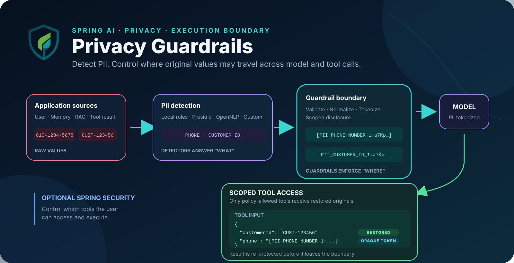
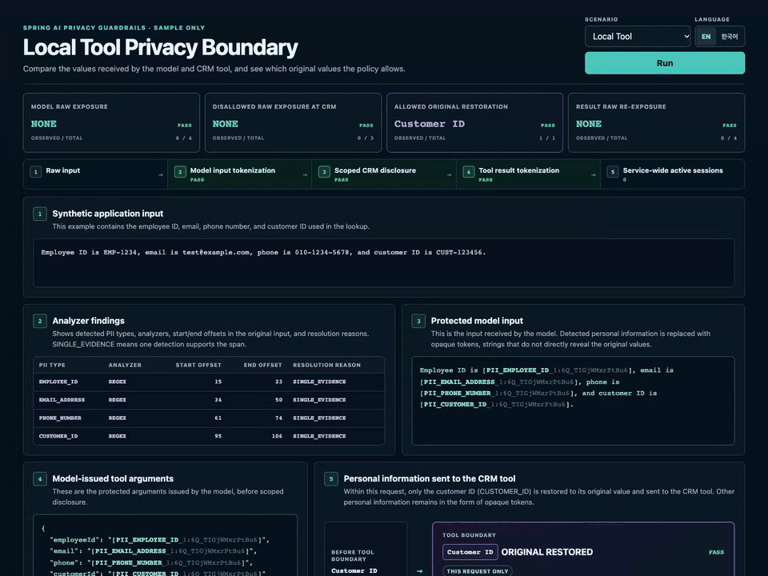

# Spring AI Privacy Guardrails

[](https://central.sonatype.com/artifact/io.github.ultramancode/spring-ai-privacy-guardrails-spring-boot-starter)
[](https://github.com/ultramancode/spring-ai-privacy-guardrails/actions/workflows/ci.yml)
[](LICENSE)

[English](README.md) | [한국어](README.ko.md) | [Documentation](https://ultramancode.github.io/spring-ai-privacy-guardrails/)

**Tokenize detected PII before it reaches the model. Reveal only the originals a tool needs, then protect its result again.**

**[Run the demo without an API key](docs/sample.md#run-the-inspector)** · **[Add to an existing Spring AI app](#add-protection-to-an-application)**

| What you need | Feature |
| --- | --- |
| Keep detected PII out of the model and allow originals only for selected tools | [Privacy](docs/privacy.md) |
| Limit tool visibility and execution using the current user's permissions | [Tool Authorization](docs/security.md) |
| Check requests and responses with rules, local ONNX or an HTTP guard model | [Content Inspection](docs/inspection.md) |

Use these features independently or together. Analyzers identify sensitive values.
This library applies the findings and policies on supported Spring AI execution paths.

<p align="center">
  <a href="docs/images/hero.svg"></a>
</p>

[View the full diagram](docs/images/hero.svg) · **Watch the demo:** [English](https://youtu.be/IeeA5ogIX_I) · [한국어](https://youtu.be/vir-x78e9j8)

**Featured in:** [Spring Blog](https://spring.io/blog/2026/08/18/this-week-in-spring-august-18-2026/) · [Awesome Spring AI](https://github.com/spring-ai-community/awesome-spring-ai#extensions-and-forks)

## Run the Sample

The default sample uses a local model and fixed examples to show enforcement.
No external service accounts or model API keys are required. Install JDK 17,
follow the [repository setup](docs/sample.md#run-the-inspector), and run from its root:

```bash
./gradlew :spring-ai-privacy-guardrails-sample-demo:run
```

At `http://127.0.0.1:8080`, open **Local Tool**. Check model raw exposure `0/4`,
allowed original restoration `1/1`, protected tool results and `PASS`. These counts
refer to the fixed example. The [Sample Guide](docs/sample.md) also explains what
to check in RAG, MCP, Security and Inspection.

<p align="center">
  <a href="docs/images/privacy-boundary-inspector-demo.gif"></a>
</p>

## Add Protection to an Application

Use Java 17, Spring AI 2.0.0 and Spring Boot 4.0.0 or later, with an application-provided
`ChatModel` whose model connection is already configured. The examples use the development
version `0.4.0-SNAPSHOT`. See [local snapshot preparation and Maven setup](docs/getting-started.md#add-the-client-starter).

Add the client starter:

```gradle
dependencies {
    implementation "io.github.ultramancode:spring-ai-privacy-guardrails-chat-client-spring-boot-starter:0.4.0-SNAPSHOT"
}
```

Select built-in presets in `src/main/resources/application.yml`. No custom rule bean is needed:

```yaml
spring:
  ai:
    privacy:
      rules:
        enabled: true
        presets: [COMMON, KR]
```

`COMMON` covers supported email and card-number formats. `KR` covers Korean mobile-phone
and resident-registration-number formats, not general names or addresses. See
[supported scope and analyzer choices](docs/getting-started.md#choose-an-analyzer).

Create a protected client in an application `@Configuration` class. Dependencies and analyzer
configuration alone do not protect existing clients:

```java
@Bean
ChatClient privacyChatClient(ChatModel chatModel, GuardrailsChatClientFactory guardrailsChatClientFactory) {
    GuardrailsPolicy guardrailsPolicy = GuardrailsPolicy.builder().privacy().build();
    return guardrailsChatClientFactory.builder(chatModel, guardrailsPolicy).build();
}
```

Inject this bean into your service with `@Qualifier("privacyChatClient")` and call it.
[Getting Started](docs/getting-started.md#create-a-protected-client) includes full imports and classes.

```java
String response = privacyChatClient.prompt()
        .user("Contact alice@example.com or 010-2345-6789.")
        .call()
        .content();
```

**The input sent to the model** looks like this. `<opaque>` stands for a request-scoped random value:

```text
Contact [PII_EMAIL_ADDRESS_1:<opaque>] or [PII_PHONE_NUMBER_1:<opaque>].
```

`response` is the model's generated answer, so it need not match this input.
Use the [model-input checks](docs/getting-started.md#call-and-check) to verify protection.
Direct calls to `ChatModel` are outside this client's protection boundary.

## Per-Tool Original Disclosure

The model receives detected values as opaque tokens. Immediately before a tool runs,
only permitted entity types are restored, and its result is protected again.
Registering a tool does not grant access to originals.

Customer lookup needs **a detection rule → rule selection → tool registration → a disclosure policy**.
`CUSTOMER_ID` is not in the built-in presets. Follow the
[complete customer lookup example](docs/getting-started.md#local-and-mcp-tools), which also
shows how to use MCP providers and final tool names.

## Add the Features You Need

| Need | Next step |
| --- | --- |
| Detect your own employee or customer identifiers | [Java rules and presets](docs/privacy.md#local-rules-and-presets) |
| Broader detection or NER models | [Presidio and OpenNLP choices](docs/getting-started.md#choose-an-analyzer) |
| Per-user tool visibility and execution | [Spring Security setup](docs/security.md#add-the-spring-boot-starter) |
| Input and optional output inspection | [Content inspection setup](docs/inspection.md#set-up-input-inspection) |
| Tokenize, redact or block PII in the final answer | [Output protection](docs/getting-started.md#protect-final-responses) |
| Diagnose unexpected behavior | [Troubleshooting](docs/troubleshooting.md) |

Output protection or inspection buffers streaming responses until the complete result is checked.
See [Architecture](docs/architecture.md) for modules and
[runtime observation](docs/privacy.md#privacy-safe-runtime-observation) for enforcement events.

## Compatibility and Status

| Component | Minimum supported version |
| --- | --- |
| Java | 17 |
| Spring AI | 2.0.0 |
| Spring Boot | 4.0.0 |
| Spring Security | 7.0.0 |

Use Spring AI 2.0.x, Spring Boot 4.x and Spring Security 7.x. The Boot starter
uses the Security version selected by the Spring Boot BOM.

Use Presidio Analyzer 2.2.361 or later to analyze structured JSON.

## Documentation

- [Getting Started](docs/getting-started.md): step-by-step starter selection and
  privacy-boundary setup
- [Configuration](docs/configuration.md): dependencies, client creation and reusable policies
- [Privacy Protection](docs/privacy.md): analyzers, tokenization, tool disclosure,
  output protection and processing limits
- [Spring Security Tool Authorization](docs/security.md): tool authorization
  policy, advanced tool configuration, Tool Search, and security-context handling
- [Content Inspection](docs/inspection.md): opt-in rules, local ONNX classifiers and HTTP guard models
- [Architecture](docs/architecture.md): modules and model, tool, and session
  execution flow
- [Threat Model](docs/threat-model.md): protected assets, trust boundaries,
  controls, limitations, and separately managed areas
- [Evaluation and Benchmarks](docs/evaluation.md): verification coverage and
  interpretation limits
- [Sample / Demo Guide](docs/sample.md): Inspector scenarios, runtime endpoints,
  and the evidence each view verifies
- [Full Sample Guide](samples/spring-ai-demo/README.md): optional analyzer and
  real-model integration examples

## Security Boundary

This library reduces the risk of accidental PII disclosure on supported Spring
AI execution paths, but it is not a complete DLP system or a guarantee of legal
compliance.

Applications remain responsible for:

- authentication, authorization policy design, application-owned execution
  paths, and logging policies.
- access control and data-retention policies for stored `ChatMemory`, vector
  stores, and databases.
- validating and tuning analyzer quality for the production environment.
- protecting response metadata and non-text media outside the explicitly
  supported reasoning text.
- authentication and transport encryption for remote analyzers.

Before using the library in production, review [Security](SECURITY.md) and the
[Threat Model](docs/threat-model.md).

## Build and Verify

```bash
./gradlew --no-daemon clean check
```

This command runs the repository's tests and verifies its module rules.
Run `./gradlew verifyDocTranslations` to check translation synchronization.
See [Evaluation](docs/evaluation.md) for the demo analyzer
regression test and JMH benchmarks.

## Contributing

See [Contributing](CONTRIBUTING.md). All contributions are provided under the
Apache License 2.0.
