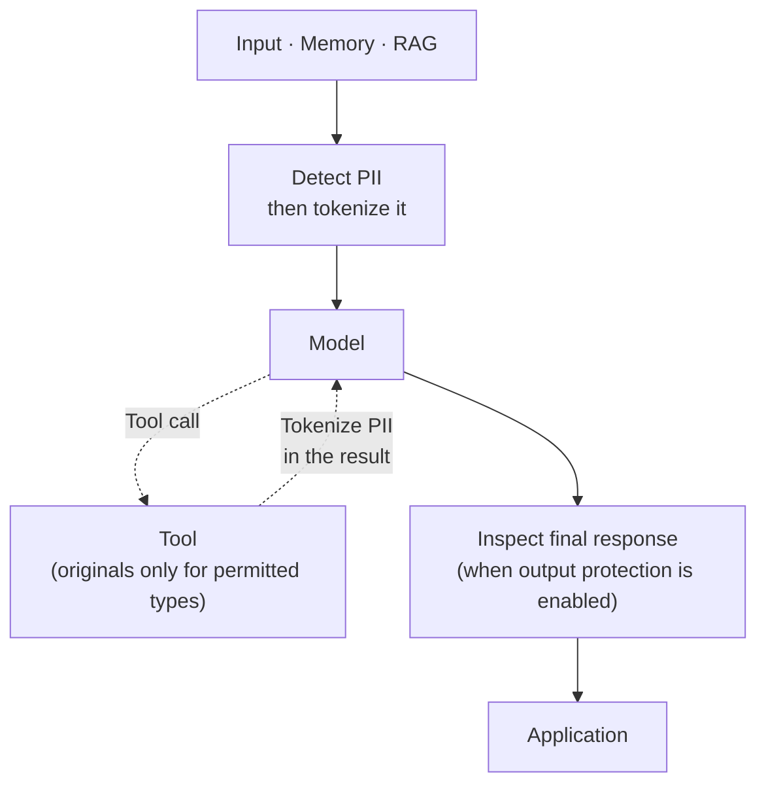
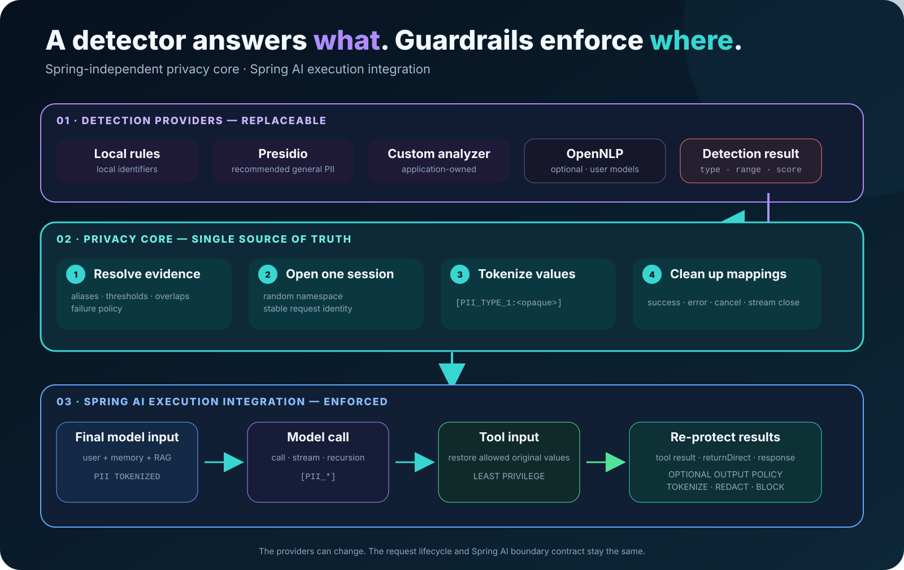

# Spring AI Privacy Guardrails

[](https://central.sonatype.com/artifact/io.github.ultramancode/spring-ai-privacy-guardrails-spring-boot-starter)
[](https://github.com/ultramancode/spring-ai-privacy-guardrails/actions/workflows/ci.yml)
[](LICENSE)

[English](README.md) | [한국어](README.ko.md) | [Documentation](https://ultramancode.github.io/spring-ai-privacy-guardrails/)

<p align="center">
  
</p>

<p align="center">
  <strong>Watch the demo:</strong>
  <a href="https://youtu.be/IeeA5ogIX_I">English</a> ·
  <a href="https://youtu.be/vir-x78e9j8">한국어</a>
</p>

**Featured In**

- **Spring Blog** — Featured in [This Week in Spring](https://spring.io/blog/2026/08/18/this-week-in-spring-august-18-2026/)
- **Spring AI Community** — Listed in [Awesome Spring AI's Extensions and Forks](https://github.com/spring-ai-community/awesome-spring-ai#extensions-and-forks)

<br>

**Detect PII with built-in and pluggable analyzers. Control where original
values may travel.**

When protection is applied to a `ChatClient`, **PII tokenization** replaces detected
values with request-scoped **opaque tokens** before the input is sent to the model.
These replacement strings do not directly reveal the original values.
Immediately before a protected tool runs, original values are restored only for
the entity types allowed by policy, and the tool result is protected again.
Final-response inspection can be enabled when needed.

Spring AI Privacy Guardrails combines a Spring-independent privacy `core` with
Spring AI integration to enforce privacy policies across chat, RAG, memory,
tool-call, and output boundaries.

The optional [Spring Security integration](docs/security.md) controls which tools
are shown to the model and checks authorization before tool execution. It can
be used independently of PII protection.

The optional [content inspection](docs/inspection.md) modules check model input and
output with application-defined rules, local ONNX classifiers or an HTTP guard model.
They can be used with or without PII protection and tool authorization.

## Why It Exists

**Detection is the first step. Control where original values go.**

Detected PII is sent to the model as opaque tokens. Tools receive only the originals
allowed by policy, and tool results are protected before they return to the model.

With the optional Spring Security integration, the model sees only tools authorized
for the user, and permissions are checked again immediately before execution.



## Run the Sample

The default sample includes a local `ChatModel`, so no external model API key is
required. With JDK 17 installed, run the following command from the
repository root:

```bash
./gradlew :spring-ai-privacy-guardrails-sample-demo:run
```

Open `http://127.0.0.1:8080` to use the sample's **Privacy Boundary
Inspector**. Compare the values the model and tools actually receive:

- **Local Tool** shows detected PII replaced with opaque tokens before reaching the
  model. Only the allowed `CUSTOMER_ID` is restored for the tool, and its result
  is protected before being sent back to the model.
- **RAG** compares the original retrieved document with the protected prompt
  received by the model.
- **MCP** shows the same protection through a local MCP tool call over
  Streamable HTTP.
- **Security** compares tool visibility and execution permissions for a general
  employee and customer support, with PII protection on the allowed call.

<p align="center">
  
</p>

Text not matched by the demo's detection rules may be returned unchanged by the
local model, and the Inspector does not expose opaque token mappings. The
[Sample Guide](samples/spring-ai-demo/README.md) covers the Local Tool, RAG, MCP,
and Security demos plus optional Presidio, OpenNLP, and real-model integration.

The default repository checks do not call remote models. See the
[Privacy Boundary Verification Matrix](docs/evaluation.md#privacy-boundary-verification-matrix)
for the corresponding reproducible automated coverage.

## Add Protection to an Application

For a step-by-step setup path, see [Getting Started](docs/getting-started.md).

The following sections use the unified client starter with an application-provided
`ChatModel`. Individual feature starters remain available for direct integration.

### Choose a PII Analyzer

PII analyzers determine **what is sensitive**. Privacy Guardrails controls
**where detected original values may flow** across model, RAG, memory, tool,
MCP, and output boundaries.

| Analyzer | Best fit |
| --- | --- |
| Presidio | Broader PII detection and NLP-backed recognition |
| Built-in Regex or custom `PiiAnalyzer` | Application-specific identifiers with predictable formats |
| Apache OpenNLP | JVM-local NER with application-supplied compatible models |

For broader PII detection, Presidio is the recommended default.

Presidio requires an external Presidio Analyzer service. OpenNLP runs in the
JVM and requires compatible models supplied by the application.

### Choose Starters

Start with the client starter and add analyzer or authorization starters as needed.

| Need | Starter |
| --- | --- |
| Policy-based clients with privacy and optional inspection | `spring-ai-privacy-guardrails-client-spring-boot-starter` |
| Presidio integration | `spring-ai-privacy-guardrails-presidio-spring-boot-starter` |
| Apache OpenNLP integration | `spring-ai-privacy-guardrails-opennlp-spring-boot-starter` |
| Principal-aware tool discovery and execution | `spring-ai-privacy-guardrails-spring-security-spring-boot-starter` |

The client, Presidio and OpenNLP starters include the base privacy starter.
There is no need to add it separately. Selecting only tool authorization does not
require an analyzer.

Content inspection requires version `0.4.0` or later. Choose an inspector implementation and follow the
[inspection setup](docs/inspection.md#set-up-input-inspection).

Adding a starter dependency alone does not apply its protection. Follow the
example below and the relevant guide to complete the setup.

### Dependency and Basic Configuration

The examples below use version `0.4.0-SNAPSHOT`.

To start without an external analyzer service, use the client starter with an
application-specific regex rule.

```gradle
dependencies {
    implementation "io.github.ultramancode:spring-ai-privacy-guardrails-client-spring-boot-starter:0.4.0-SNAPSHOT"
}
```

```yaml
spring:
  ai:
    guardrails:
      privacy: true
    privacy:
      output:
        enabled: true
        action: tokenize
      regex:
        enabled: true
        rules:
          - entity-type: EMPLOYEE_ID
            pattern: "(?<![A-Za-z0-9_])EMP-[0-9]{4}(?![A-Za-z0-9_])"
            score: 0.90
```

The `output` section is optional. When omitted, privacy output protection is
disabled.

This example rule is application-specific and detects only values in the
`EMP-1234` format. It does not establish general PII-detection performance.
Validate analyzers for production using data representative of your
environment.

### Protect a ChatClient

Use the factory for clients that should follow the configured policy.

```java
@Bean
ChatClient privacyChatClient(ChatModel chatModel, GuardrailsChatClientFactory guardrails) {
    return guardrails.builder(chatModel).build();
}
```

Enable `spring.ai.guardrails.privacy=true` and configure an analyzer.
The same factory supports inspection and tool authorization. See
[Client policies](docs/clients.md) for feature selection and explicit Java policies.

Direct calls to a `ChatModel` are outside the automatic protection boundary.
See [Configuration](docs/configuration.md) for derived clients, analyzer
combinations, and failure policies.

## Per-Tool Original Disclosure

Registering a tool does not grant access to original PII values. Disclosure is
deny-by-default. Original values are restored immediately before execution only
when the policy lists both the exact, case-sensitive tool name and the required
canonical entity types.

```yaml
spring:
  ai:
    privacy:
      tools:
        disclosures:
          customerLookup:
            - CUSTOMER_ID
```

Register application tools and MCP providers directly:

```java
ChatClient client = guardrails.builder(chatModel)
        .defaultTools(customerLookupToolCallback, mcpToolCallbackProvider)
        .build();
```

Privacy applies to each request's resolved tools, including tools added with
`.tools(...)` and refreshed provider lists. Tool results are protected again
before reaching the model or application.

Custom tool-execution paths outside Spring AI's standard registration flow
require separate protection. See
[Per-Tool Original Disclosure](docs/configuration.md#per-tool-original-disclosure)
for the complete rules.

## Optional Spring Security Tool Authorization

Applications can add the Spring Security starter to keep
unauthorized tool specifications, including names, descriptions, and input
schemas, out of the model and re-authorize execution before any allowed
original PII is restored.

```gradle
dependencies {
    implementation "io.github.ultramancode:spring-ai-privacy-guardrails-spring-security-spring-boot-starter:0.4.0-SNAPSHOT"
}
```

Provide an `AuthorizationManager<ToolAuthorizationContext>` bean and select
`spring.ai.guardrails.tool-authorization=true`. Keep using
`guardrails.builder(chatModel)`. Select privacy separately when needed.
Authentication remains the application's responsibility.

When combined with privacy protection, tool authorization and original-value
disclosure remain separate policies. Authorization determines which tools the
current principal may discover or execute. Disclosure policy determines which
original PII values an authorized tool may receive. Keep all Privacy Guardrails
artifacts on the same version.

See [Spring Security Tool Authorization](docs/security.md) for complete setup,
required APIs, and supported paths.

## Core Protection Behavior

<p align="center">
  
</p>

- Each protected request uses an isolated `PrivacySession`. Detected PII in
  supported model input, including memory and RAG content, is replaced with opaque tokens before
  the model call.
- Protected tools receive only original values allowed by policy. Structured
  tool input remains least-privilege, and tool results are protected again
  before they reach the model or application, including `returnDirect`.
- When enabled, output protection applies `TOKENIZE`, `REDACT`, or `BLOCK` to
  completed responses. Streaming responses are buffered for inspection, and
  managed session mappings are cleared on completion, failure, or cancellation.

See [Configuration](docs/configuration.md) for detailed behavior and
[Architecture](docs/architecture.md) for request flow and module
responsibilities.

## Privacy-Safe Runtime Observation

Applications can optionally register a `PrivacyEnforcementObserver` to receive
privacy enforcement events at supported model, tool-input, tool-result, and
application-output boundaries. Each event contains only `boundary`, identifying
where it occurred, and `outcome`, describing the result at that boundary. It does
not include PII, opaque tokens, payloads, tool names, or request identifiers.

See [Privacy-Safe Runtime Observation](docs/configuration.md#privacy-safe-runtime-observation)
for registration, outcome semantics, and callback execution guidance.

## Library Modules

See [Content Inspection](docs/inspection.md) to inspect model input and responses
with rules, local ONNX text classification models or an HTTP guard model, and
combine inspection with privacy protection.

Analyzer-specific starters bring in their runtime modules as transitive
dependencies. Add test support separately in the application's test scope.

| Module | Purpose |
| --- | --- |
| `spring-ai-privacy-guardrails-core` | PII detection and tokenization, built-in Regex analysis, and request-scoped sessions |
| `spring-ai-privacy-guardrails-spring-ai-boundary` | Combines privacy protection, tool authorization, and content inspection before model calls |
| `spring-ai-privacy-guardrails-spring-ai` | Privacy protection for Spring AI model calls, tool execution, and responses |
| `spring-ai-privacy-guardrails-presidio` | Presidio Analyzer HTTP adapter |
| `spring-ai-privacy-guardrails-opennlp` | JVM-only adapter for user-supplied OpenNLP models |
| `spring-ai-privacy-guardrails-spring-security` | Tool discovery and execution permission checks using Spring Security |
| `spring-ai-privacy-guardrails-spring-security-spring-boot-starter` | Spring Boot configuration for tool authorization |
| `spring-ai-privacy-guardrails-inspection-core` | Content inspection, allow/block policies, and inspection results |
| `spring-ai-privacy-guardrails-inspection-rules` | Literal and RE2/J inspectors |
| `spring-ai-privacy-guardrails-inspection-onnx` | Local content inspection with ONNX |
| `spring-ai-privacy-guardrails-inspection-openai-compatible` | Calls guard models through OpenAI-compatible HTTP APIs |
| `spring-ai-privacy-guardrails-inspection-spring-ai` | Model-input inspection and optional output inspection |
| `spring-ai-privacy-guardrails-inspection-spring-boot-starter` | Spring Boot configuration for inspecting selected clients |
| `spring-ai-privacy-guardrails-client` | Policy-based client assembly and automatic tool protection |
| `spring-ai-privacy-guardrails-client-spring-boot-starter` | Default client policy and component wiring |
| `spring-ai-privacy-guardrails-test` | Optional model and tool probes with AssertJ assertions |

See [Architecture](docs/architecture.md) for module responsibilities and the
dependency structure. The repository-only JMH benchmark module is not
published as a library. Its workloads and execution instructions are described
in [Evaluation](docs/evaluation.md#jmh-benchmarks).

## Compatibility and Status

| Component | Minimum supported version |
| --- | --- |
| Java | 17 |
| Spring AI | 2.0.0 |
| Spring Boot | 4.0.0 |
| Spring Security | 7.0.0 |

Use Spring AI 2.0.x, Spring Boot 4.x and Spring Security 7.x. The Boot starter
uses the Security version selected by the Spring Boot BOM. Standalone Security
integration compiles against 7.0.0. Repository dependency versions are configured
in [gradle.properties](gradle.properties).

Use Presidio Analyzer 2.2.361 or later to analyze structured JSON.

## Documentation

- [Getting Started](docs/getting-started.md): step-by-step starter selection and
  privacy-boundary setup
- [Configuration](docs/configuration.md): starters, analyzers, tool policies,
  and output policies
- [Spring Security Tool Authorization](docs/security.md): tool authorization
  policy, advanced tool configuration, Tool Search, and security-context handling
- [Content Inspection](docs/inspection.md): opt-in rules, local ONNX classifiers and HTTP guard models
- [Architecture](docs/architecture.md): modules and model, tool, and session
  execution flow
- [Threat Model](docs/threat-model.md): protected assets, trust boundaries,
  controls, limitations, and separately managed areas
- [Evaluation and Benchmarks](docs/evaluation.md): verification coverage and
  interpretation limits
- [Sample / Demo Guide](docs/sample.md): Inspector scenarios, runtime endpoints,
  and the evidence each view verifies
- [Full Sample Guide](samples/spring-ai-demo/README.md): optional analyzer and
  real-model integration examples

## Security Boundary

This library reduces the risk of accidental PII disclosure on supported Spring
AI execution paths, but it is not a complete DLP system or a guarantee of legal
compliance.

Applications remain responsible for:

- authentication, authorization policy design, application-owned execution
  paths, and logging policies.
- access control and data-retention policies for stored `ChatMemory`, vector
  stores, and databases.
- validating and tuning analyzer quality for the production environment.
- protecting response metadata and non-text media outside the explicitly
  supported reasoning text.
- authentication and transport encryption for remote analyzers.

Before using the library in production, review [Security](SECURITY.md) and the
[Threat Model](docs/threat-model.md).

## Build and Verify

```bash
./gradlew --no-daemon clean check
```

This command runs the repository's tests and verifies its module rules.
Run `./gradlew verifyDocTranslations` to check translation synchronization.
See [Evaluation](docs/evaluation.md) for the demo analyzer
regression test and JMH benchmarks.

## Contributing

See [Contributing](CONTRIBUTING.md). All contributions are provided under the
Apache License 2.0.
