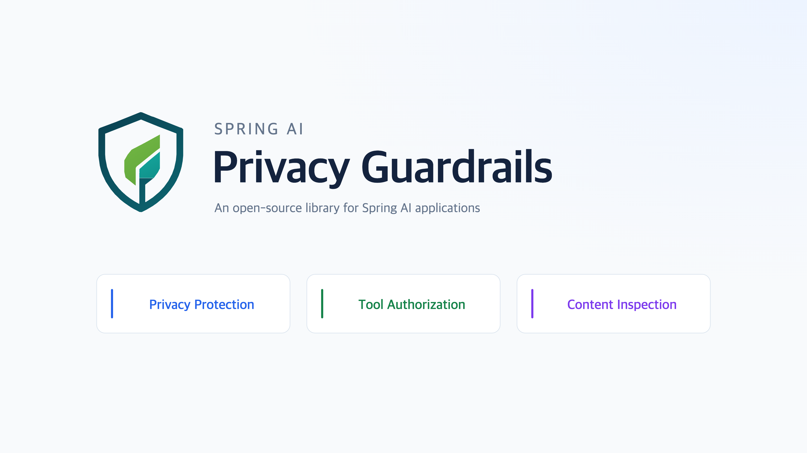
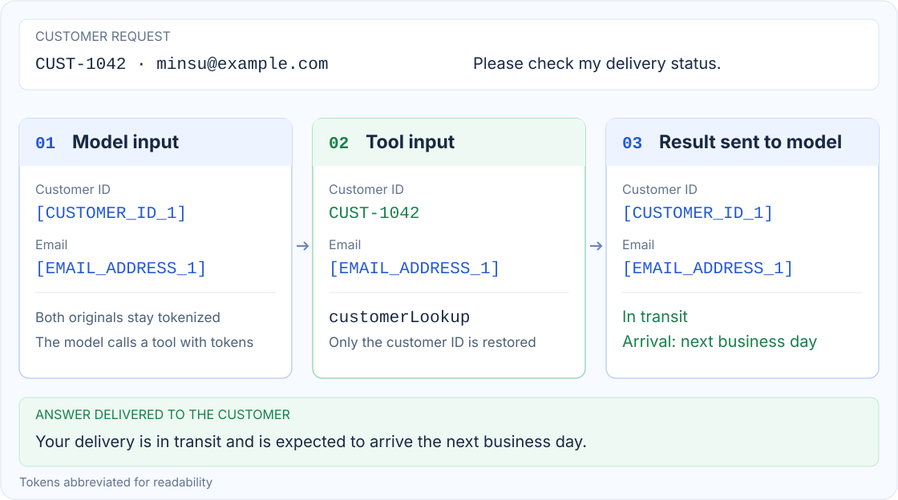
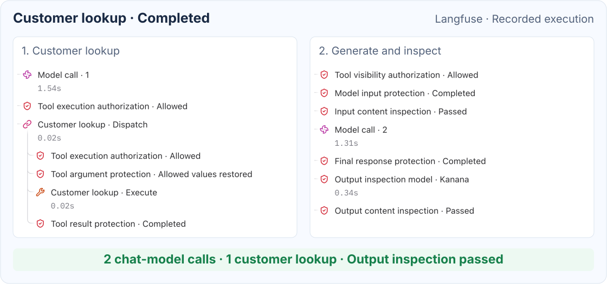
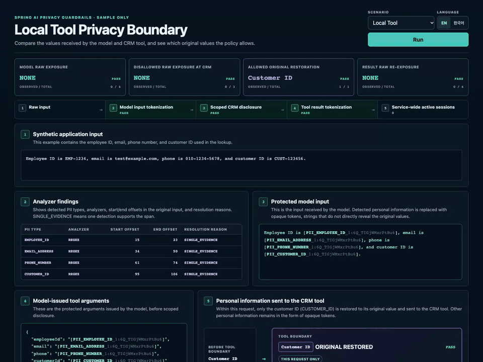

# Spring AI Privacy Guardrails

**English** | [한국어](ko/index.md)

**Send tokens to the model. Give each tool only the originals its policy allows.**

 

  

  <strong>Demo videos (YouTube):</strong>
  <a href="https://www.youtube.com/watch?v=gu5pPaA-NQc&amp;t=5s">English</a> ·
  <a href="https://www.youtube.com/watch?v=AqlubcLOtSc">한국어</a>

## Featured in

- [Spring Blog — This Week in Spring](https://spring.io/blog/2026/08/18/this-week-in-spring-august-18-2026/)
- [Awesome Spring AI](https://github.com/spring-ai-community/awesome-spring-ai#extensions-and-forks)

## Select the Protection You Need

| What you need | Start here |
| --- | --- |
| PII tokenization and per-tool original disclosure | [Privacy setup](getting-started.md#privacy-protection) |
| Tool visibility and execution based on the user's permissions | [Tool authorization setup](getting-started.md#tool-authorization) |
| Request and response checks using rules, ONNX or an HTTP model | [Content inspection setup](getting-started.md#content-inspection) |

Use these features independently or together.

## See It in Action

A customer asks for a delivery update with a customer ID and an email address.
The model calls the lookup tool with tokens. Only the customer ID is restored for the tool,
and PII in its result is protected again before it returns to the model.

This example uses a custom detection rule for customer IDs
and a per-tool disclosure policy for the lookup tool.

 

**Execution trace**

Two model calls surround one customer lookup, and the final response passes output inspection.
The application records model/tool calls and guardrail decisions together.

## Reference

| Guide | Covers |
| --- | --- |
| [Getting Started](getting-started.md) | Common setup and first steps for privacy protection, tool authorization and content inspection. |
| [Configuration](configuration.md) | Dependencies, client creation, feature selection and policy reuse. |
| [Sample Guide](sample.md) | Inspector scenarios, expected results, endpoints, and language selection. |
| [Privacy Protection](privacy.md) | Analyzers, tokenization, tool disclosure, output protection and processing limits. |
| [Spring Security Tool Authorization](security.md) | Optional principal-aware tool discovery and execution checks, Tool Search, and asynchronous context. |
| [Content Inspection](inspection.md) | Input and optional output inspection with rules, local ONNX text classification models or HTTP guard models. |
| [Runtime Observation](observability.md) | Recorded normal and blocked requests and Observer usage. |
| [Architecture](architecture.md) | Module boundaries, request sessions, evidence resolution, and execution lifecycle. |
| [Threat model](threat-model.md) | Protected assets, trust boundaries, controls, limitations, and separately managed areas. |
| [Evaluation](evaluation.md) | Boundary tests, the deterministic analyzer baseline, and repository benchmarks. |
| [Troubleshooting](troubleshooting.md) | PII detection, rule selection, tool disclosure, authorization, streaming and inspection setup issues. |

## Sample

The sample application uses fixed examples to illustrate Local Tool, RAG, MCP, Security and Inspection.
See the [Sample Guide](sample.md) for scenarios and run instructions.

