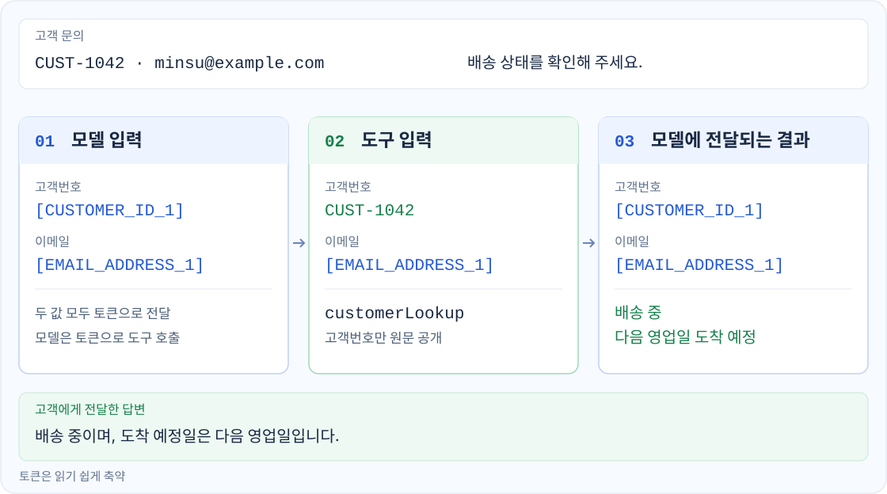
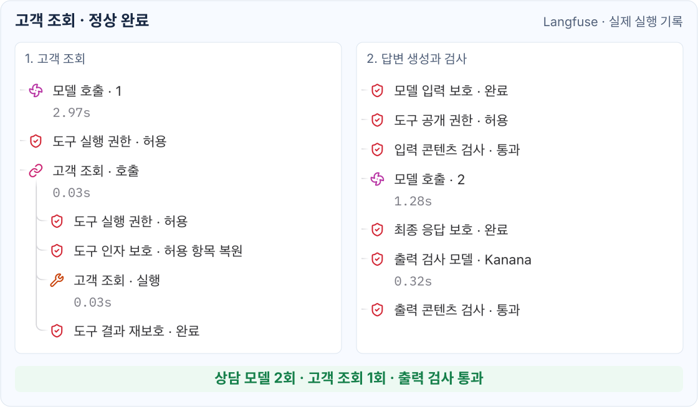
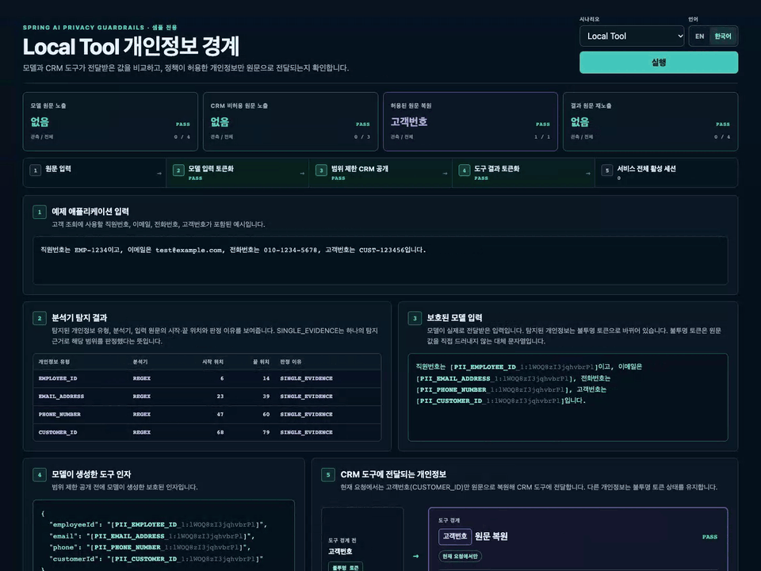

# Spring AI Privacy Guardrails

[English](../index.md) | **한국어**

<!-- i18n-source: docs/index.md -->
<!-- i18n-source-sha256: 4cf185cb24cf4c0d9ea5386d229be4b2f23111c4678c0e18bd15f3f771e270cd -->

**모델에는 토큰을, 도구에는 정책이 허용한 원문만 전달합니다.**

 

  

  <strong>데모 영상 (YouTube):</strong>
  <a href="https://www.youtube.com/watch?v=AqlubcLOtSc">한국어</a> ·
  <a href="https://www.youtube.com/watch?v=gu5pPaA-NQc&amp;t=5s">English</a>

## 외부 소개

- [Spring 공식 블로그 — This Week in Spring](https://spring.io/blog/2026/08/18/this-week-in-spring-august-18-2026/)
- [Awesome Spring AI](https://github.com/spring-ai-community/awesome-spring-ai#extensions-and-forks)

## 필요한 보호 선택

| 원하는 동작 | 시작할 곳 |
| --- | --- |
| 개인정보 토큰화와 도구별 최소 원문 공개 | [개인정보 보호 설정](getting-started.md#privacy-protection) |
| 사용자 권한에 따른 도구 공개·실행 | [도구 권한 설정](getting-started.md#tool-authorization) |
| 규칙·ONNX·HTTP 모델을 이용한 요청·응답 검사 | [콘텐츠 검사 설정](getting-started.md#content-inspection) |

세 기능은 독립적으로 선택하거나 조합할 수 있습니다.

## 실제 동작 예시

고객이 고객번호와 이메일로 배송 상태를 문의하면 모델은 토큰으로 조회 도구를 호출합니다.
도구에는 고객번호만 복원하고, 조회 결과의 개인정보는 모델에 다시 전달하기 전에 보호합니다.

고객번호에는 사용자 정의 탐지 규칙을, 조회 도구에는 원문 공개 정책을 적용한 예시입니다.

 

**실행 기록**

아래는 고객 조회와 출력 검사를 거쳐 정상 완료된 별도 요청의 실행 기록입니다.
앱에서 모델·도구 호출과 가드레일 판정을 함께 기록했습니다.

## 참고 문서

| 가이드 | 다루는 내용 |
| --- | --- |
| [시작하기](getting-started.md) | 공통 설정과 개인정보 보호·도구 권한·콘텐츠 검사 시작 안내 |
| [설정](configuration.md) | 의존성, 클라이언트 생성, 기능 선택과 정책 재사용 |
| [샘플 가이드](sample.md) | Inspector 시나리오, 예상 결과, 엔드포인트와 언어 선택 |
| [개인정보 보호](privacy.md) | 분석기, 토큰화, 도구 원문 공개, 출력 보호와 처리 한도 |
| [Spring Security 도구 권한](security.md) | 사용자별 도구 공개·실행 권한 검사, Tool Search와 비동기 보안 컨텍스트 |
| [콘텐츠 검사](inspection.md) | 규칙, 로컬 ONNX 텍스트 분류 모델, HTTP 검사 모델을 통한 입력 검사와 선택적 출력 검사 |
| [런타임 관측](observability.md) | 정상·차단 실행 기록과 Observer 사용법 |
| [아키텍처](architecture.md) | 모듈 경계, 요청 세션, 탐지 결과 해석과 실행 수명 주기 |
| [위협 모델](threat-model.md) | 보호 대상, 신뢰 경계, 통제, 한계와 별도 관리 영역 |
| [평가와 벤치마크](evaluation.md) | 경계 테스트, 재현 가능한 분석기 기준선과 프로젝트 벤치마크 |
| [문제 해결](troubleshooting.md) | 개인정보 탐지, 규칙 선택, 도구 원문 공개, 권한, 스트리밍과 콘텐츠 검사 설정 문제 진단 |

## 샘플

샘플 애플리케이션은 고정된 예제로 Local Tool, RAG, MCP, Security, Inspection의 동작을 보여줍니다.
시나리오와 실행 방법은 [샘플 가이드](sample.md)를 참고하세요.

