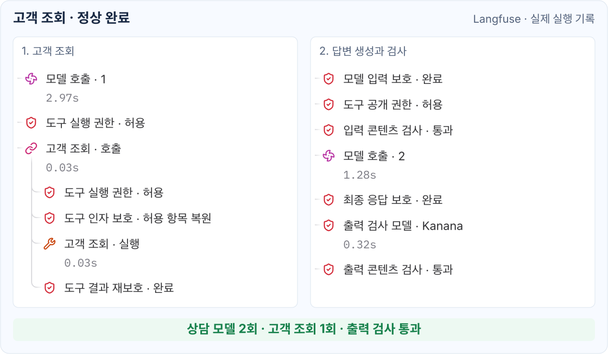
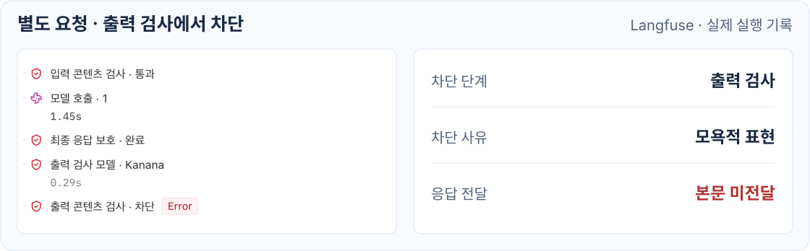

# 런타임 관측

[English](../observability.md) | **한국어**

<!-- i18n-source: docs/observability.md -->
<!-- i18n-source-sha256: ccb5e144552deca4252a821a58f56e3ef778ebb241de2054f954f3e28e61cc87 -->

앱은 Observer로 개인정보 보호가 실행된 경계와 콘텐츠 검사 판정을 기록할 수 있습니다.
검사기 관측으로는 검사기마다 걸린 시간을 확인할 수 있습니다.

## 정상 완료된 고객 조회

두 열은 하나의 고객 조회 요청에서 이어지는 실행 구간을 보여줍니다.

앱에서 모델·도구 호출 기록과 Observer 결과를 함께 Langfuse에 표시한 예시입니다.

1. 첫 모델 호출이 고객 조회를 요청합니다. 조회 과정에 도구 권한과 개인정보 보호 결과가 기록됩니다.
2. 도구 결과는 다음 모델 요청 전에 보호됩니다. 해당 요청의 입력 검사도 통과합니다.
3. 두 번째 모델 호출이 답변을 생성합니다. 최종 응답 보호와 출력 검사를 마친 뒤 답변을 전달합니다.

상담 모델 호출 두 번과 출력 검사 호출은 별개입니다.
고객 조회의 호출·실행 행은 같은 조회를 나타내며, 업무 도구가 두 번 실행됐다는 뜻은 아닙니다.

## 생성 후 전달이 차단된 응답

아래는 별도 요청의 실행 기록입니다.
입력 검사는 통과했지만, 출력 검사에서 답변의 모욕적인 표현을 감지해 응답 전달을 차단했습니다.

이 기록의 `Error`는 출력 검사로 응답 전달이 차단됐음을 나타냅니다.

이 검사를 적용하려면 [최종 출력 검사](inspection.md#선택적-최종-출력-검사)를 활성화해야 합니다.

## 라이브러리가 전달하는 정보

| 출처 | 제공하는 정보 | 활용 예시 |
| --- | --- | --- |
| `PrivacyEnforcementObserver` | 개인정보 보호 경계와 처리 결과 | 모델 입력 보호, 도구 입력 원문 공개, 출력 차단 이벤트 집계 |
| `InspectionObserver` | 검사 단계, 스트리밍 여부, 판정과 검사기별 결과 또는 실패 | 입력·출력 판정 집계, 탐지 범주·코드·선택적 점수 확인 |
| [검사기 관측](#검사기-관측) | 검사기 실행별 소요 시간, 검사기 ID, 검사 단계, 판정, 실패 코드 | 검사기를 추적 구간으로 표시, 검사기별 소요 시간 비교 |

`PROTECTED`는 해당 경계의 처리가 완료됐다는 뜻이며 개인정보 탐지나 내용 변경 여부를 나타내지 않습니다.
한 요청에서 여러 이벤트가 발생할 수 있으므로 이벤트 수와 요청 수는 다릅니다.

## Observer 연결

ChatClient Spring Boot 스타터에서는 `PrivacyEnforcementObserver` 빈과 `InspectionObserver` 빈을 등록합니다.
Factory를 직접 구성할 때는 `GuardrailsChatClientFactory.builder()`에
`privacyObserver(...)`와 `inspectionObserver(...)`를 지정합니다.

Observer 등록 예제는 다음 문서를 참고하세요.

- [개인정보 보호 런타임 관측](privacy.md#개인정보-보호-런타임-관측)
- [검사 결과 기록](inspection.md#검사-결과-기록)

Langfuse 연동, 요청별 이벤트 연결과 검사기 관측 외의 소요 시간 측정은 앱에서 구성합니다.

## 검사기 관측

검사기를 실행할 때마다 `spring.ai.inspector`라는 이름의 Micrometer `Observation`으로 알립니다.
Micrometer 추적을 사용하면 각 실행이 `inspect <검사기 ID>` 이름의 구간으로 표시됩니다.
Micrometer 지표를 사용하면 실행 시간이 타이머로 기록됩니다.

| 키 | 값 |
| --- | --- |
| `spring.ai.inspector.id` | 설정한 검사기 ID |
| `spring.ai.inspector.phase` | `MODEL_REQUEST` 또는 `FINAL_OUTPUT` |
| `spring.ai.inspector.decision` | `ALLOW`, `BLOCK`, 판정 전에 예외로 검사가 멈추면 `none` |
| `spring.ai.inspector.failure.code` | `TIMEOUT` 같은 검사기 실패 코드, 실패하지 않았으면 `none` |

`decision`은 해당 검사기 다음의 검사 판정입니다. `BLOCK`은 콘텐츠 정책이 탐지 결과를
차단했거나 실패를 `FAIL_CLOSED`로 처리해 그 검사기에서 검사가 멈췄다는 뜻입니다.
`ALLOW`는 다음 검사기로 넘어갔거나 요청이 허용됐다는 뜻입니다.
실패한 뒤 `FAIL_OPEN`으로 허용된 검사기는 `decision=ALLOW`와 실패 코드를 함께 가집니다.
실패 코드가 있는 관측에는 오류도 기록됩니다.
키에는 프롬프트, 응답, 탐지 결과가 들어가지 않습니다.

검사기 관측은 스트리밍 호출을 포함해 ChatClient의 advisor 관측 아래에 기록됩니다.

- 입력 검사기는 도구 반복을 포함한 각 모델 호출 전에 `ModelRequestBoundaryAdvisor` 아래에서 실행됩니다.
- 출력 검사기는 응답이 완성된 뒤 `InspectionOutputAdvisor` 아래에서 실행됩니다.

advisor 관측에는 뒤이은 advisor와 모델 호출 시간이 포함됩니다.
검사에 걸린 시간은 검사기 관측으로 확인하세요.

검사가 앞에서 멈췄거나 개인정보 처리 요건을 충족하지 못해 실행되지 않은 검사기는
기록되지 않습니다. 이때도 `InspectionObserver`는 검사 보고서나 실패를 받습니다.

### 관측 연결

ChatClient Spring Boot 스타터와 검사 스타터는 앱의 `ObservationRegistry` 빈을 사용합니다.
빈이 없으면 검사기 관측을 기록하지 않습니다.
이름이나 키를 바꾸려면 `InspectorObservationConvention` 빈을 등록합니다.
Factory를 직접 구성할 때는 `GuardrailsChatClientFactory.builder()`에
`observationRegistry(...)`와 `inspectorObservationConvention(...)`을 지정합니다.
`InspectionChatClientConfigurer`나 `InspectionOutputAdvisor`를 직접 생성할 때는
`ChatClient`에 넘긴 것과 같은 `ObservationRegistry`를 전달합니다.
