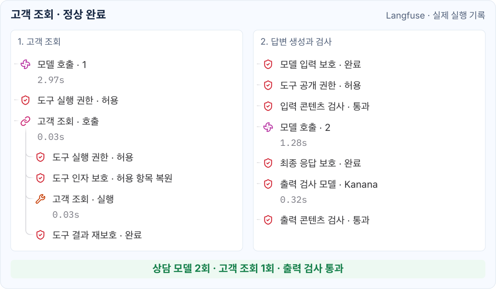
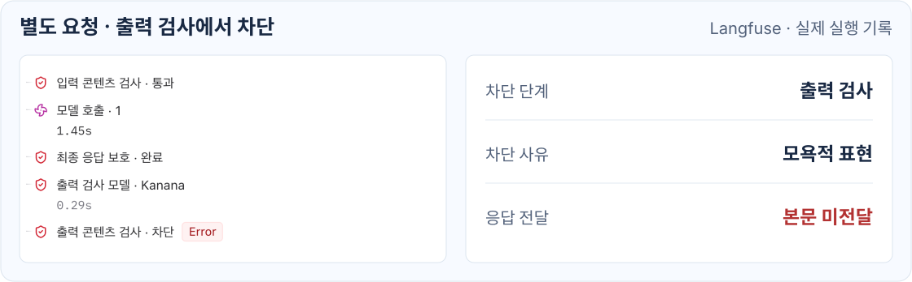

# 런타임 관측

[English](../observability.md) | **한국어**

<!-- i18n-source: docs/observability.md -->
<!-- i18n-source-sha256: c8c00db7a37b3a723ff6ad832959fb2dafeea8887ad4ff91d7937972ef3d242d -->

앱은 Observer로 개인정보 보호가 실행된 경계와 콘텐츠 검사 판정을 기록할 수 있습니다.

## 정상 완료된 고객 조회

두 열은 하나의 고객 조회 요청에서 이어지는 실행 구간을 보여줍니다.

앱에서 모델·도구 호출 기록과 Observer 결과를 함께 Langfuse에 표시한 예시입니다.

1. 첫 모델 호출이 고객 조회를 요청합니다. 조회 과정에 도구 권한과 개인정보 보호 결과가 기록됩니다.
2. 도구 결과는 다음 모델 요청 전에 보호됩니다. 해당 요청의 입력 검사도 통과합니다.
3. 두 번째 모델 호출이 답변을 생성합니다. 최종 응답 보호와 출력 검사를 마친 뒤 답변을 전달합니다.

상담 모델 호출 두 번과 출력 검사 호출은 별개입니다.
고객 조회의 호출·실행 행은 같은 조회를 나타내며, 업무 도구가 두 번 실행됐다는 뜻은 아닙니다.

## 생성 후 전달이 차단된 응답

아래는 별도 요청의 실행 기록입니다.
입력 검사는 통과했지만, 출력 검사에서 답변의 모욕적인 표현을 감지해 응답 전달을 차단했습니다.

이 기록의 `Error`는 출력 검사로 응답 전달이 차단됐음을 나타냅니다.

이 검사를 적용하려면 [최종 출력 검사](inspection.md#선택적-최종-출력-검사)를 활성화해야 합니다.

## 라이브러리가 전달하는 정보

| 출처 | 제공하는 정보 | 활용 예시 |
| --- | --- | --- |
| `PrivacyEnforcementObserver` | 개인정보 보호 경계와 처리 결과 | 모델 입력 보호, 도구 입력 원문 공개, 출력 차단 이벤트 집계 |
| `InspectionObserver` | 검사 단계, 스트리밍 여부, 판정과 검사기별 결과 또는 실패 | 입력·출력 판정 집계, 탐지 범주·코드·선택적 점수 확인 |

`PROTECTED`는 해당 경계의 처리가 완료됐다는 뜻이며 개인정보 탐지나 내용 변경 여부를 나타내지 않습니다.
한 요청에서 여러 이벤트가 발생할 수 있으므로 이벤트 수와 요청 수는 다릅니다.

## Observer 연결

ChatClient Spring Boot 스타터에서는 `PrivacyEnforcementObserver` 빈과 `InspectionObserver` 빈을 등록합니다.
Factory를 직접 구성할 때는 `GuardrailsChatClientFactory.builder()`에
`privacyObserver(...)`와 `inspectionObserver(...)`를 지정합니다.

Observer 등록 예제는 다음 문서를 참고하세요.

- [개인정보 보호 런타임 관측](privacy.md#개인정보-보호-런타임-관측)
- [검사 결과 기록](inspection.md#검사-결과-기록)

Langfuse 연동, 요청별 이벤트 연결과 소요 시간 측정은 앱에서 구성합니다.
