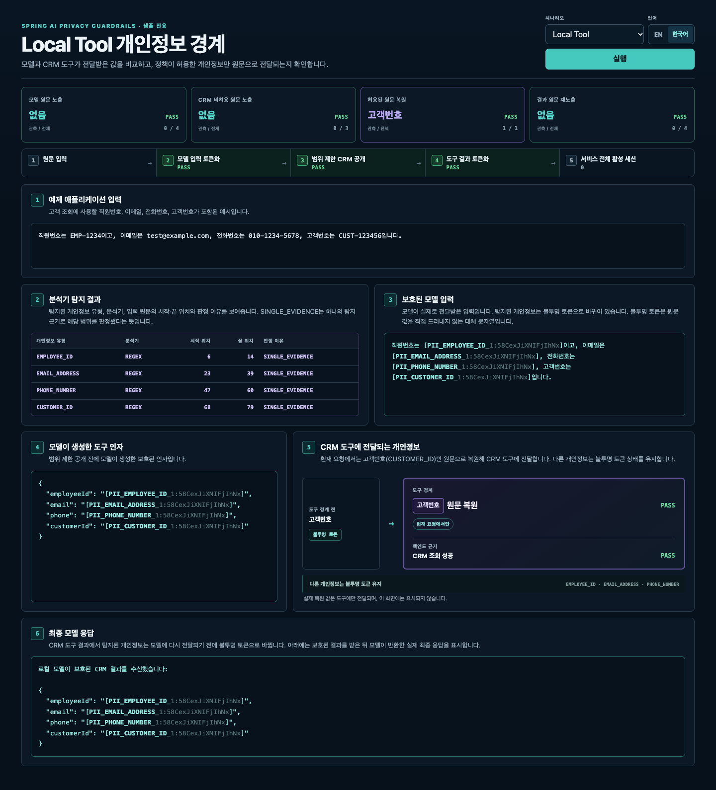
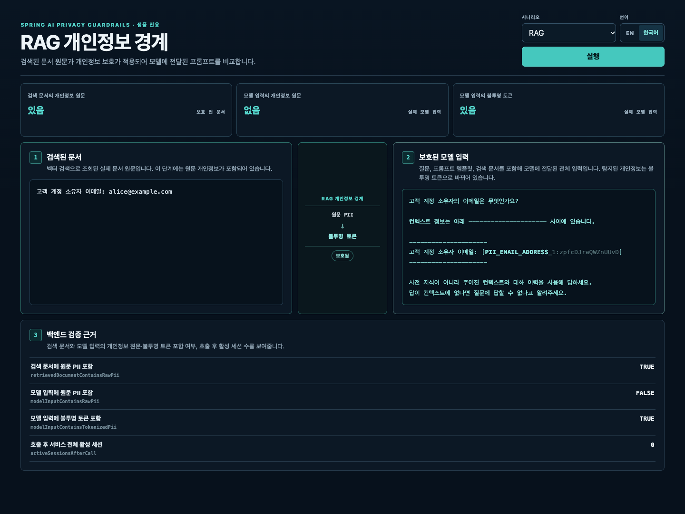
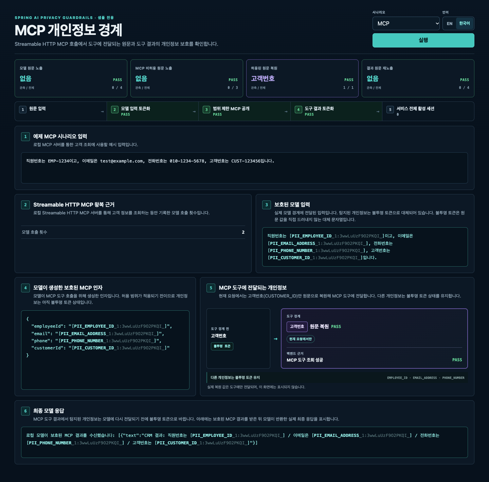

# 샘플 가이드

[English](../sample.md) | **한국어**

<!-- i18n-source: docs/sample.md -->
<!-- i18n-source-sha256: 4d5e5615490a8dea7b293c7c29dfab8960547622219733562874f48d7873985e -->

샘플은 고정된 예제로 개인정보 보호, 도구 권한과 콘텐츠 검사를 보여줍니다.
**Privacy Boundary Inspector**에서 Local Tool, RAG, MCP, Security, Inspection 시나리오를
확인할 수 있습니다. 기본 구성은 정해진 응답을 반환하는 로컬 `ChatModel`을 사용하고,
문서 검색과 MCP 서버도 로컬 환경에서 실행합니다.

<a id="run-the-inspector"></a>

## Inspector 실행

Git과 JDK 17 이상을 설치합니다. 외부 서비스 계정이나 API 키는 필요하지 않습니다.
처음 실행할 때 Gradle과 의존성을 다운로드하므로 네트워크 연결이 필요합니다.

```bash
git clone https://github.com/ultramancode/spring-ai-privacy-guardrails.git
cd spring-ai-privacy-guardrails
git checkout v0.4.0
./gradlew :spring-ai-privacy-guardrails-sample-demo:run
```

서버가 시작되면 `http://127.0.0.1:8080`을 엽니다. 로컬 접속만 허용합니다.

Inspector에서 확인할 시나리오를 선택하세요. `EN | 한국어`는 UI와 고정 예제의 언어를 바꿉니다.

| 시나리오 | 확인할 동작 | 앱에 적용 |
| --- | --- | --- |
| Local Tool | 모델 토큰화, 고객번호만 원문 복원, 결과 재보호 | [도구 공개 정책](privacy.md#도구별-원문-공개) |
| RAG | 원문 문서와 모델에 전달되는 보호된 복사본 비교 | [메모리·RAG](configuration.md#advisor-구성) |
| MCP | 로컬 Streamable HTTP 도구 호출의 보호 | [MCP 제공자](privacy.md#도구별-원문-공개) |
| Security | 사용자 역할에 따른 도구 공개·실행과 허용 호출의 개인정보 보호 | [권한 설정](security.md) |
| Inspection | 입력 차단 전 호출 0회, 출력 차단 시 호출 1회와 응답 비공개, 통과 사례 | [검사 설정](inspection.md) |

고정 예제 다음에는 [사용자 입력 API](#inspect-results-through-the-api)로 자신의 합성 입력을 확인하거나
[전체 샘플 가이드](https://github.com/ultramancode/spring-ai-privacy-guardrails/blob/v0.4.0/samples/spring-ai-demo/README.ko.md)의 분석기·실제 모델 프로필을 선택하세요.
예상과 다르면 [문제 해결](troubleshooting.md)을 참고하세요.

<div style="position: relative; width: 100%; aspect-ratio: 16 / 9;">
  <iframe
    src="https://www.youtube-nocookie.com/embed/vir-x78e9j8"
    title="Spring AI Privacy Guardrails 한국어 데모"
    style="position: absolute; inset: 0; width: 100%; height: 100%; border: 0;"
    loading="lazy"
    referrerpolicy="strict-origin-when-cross-origin"
    allow="accelerometer; autoplay; clipboard-write; encrypted-media; gyroscope; picture-in-picture; web-share"
    allowfullscreen>
  </iframe>
</div>

## 시나리오별 확인 방법

### Local Tool

샘플은 탐지된 개인정보를 원문 값을 직접 드러내지 않는 대체 문자열인 불투명 토큰(opaque token)으로
바꿉니다. **Local Tool**을 선택하고 단계별로 전달되는 값을 확인하세요.

1. **모델 입력과 도구 인자:** 예제의 사번, 이메일, 전화번호, 고객번호가 모두 불투명 토큰으로
   바뀝니다. 모델이 생성한 도구 인자에도 이 불투명 토큰이 사용됩니다.
2. **도구 실행:** 고객 정보를 조회하는 CRM 도구에는 정책이 허용한 고객번호
   (`CUSTOMER_ID`)만 원문으로 전달됩니다. 나머지 세 값은 불투명 토큰 상태를 유지합니다.
3. **도구 결과:** 결과에서 탐지된 개인정보는 모델에 다시 전달되기 전에 불투명 토큰으로
   바뀝니다.

화면 상단의 ‘관측 / 전체’는 검사한 예제 값 중 원문이 확인된 개수를 나타냅니다.
예를 들어 ‘모델 원문 노출’의 `0/4`는 네 값 모두 원문이 모델에서 발견되지 않았다는
뜻이고, ‘허용된 원문 복원’의 `1/1`은 허용된 고객번호가 원문으로 전달되었다는 뜻입니다.
각 항목에는 `PASS` 또는 `FAIL`도 표시됩니다.



### RAG

**RAG**를 선택하고 검색된 문서와 모델이 전달받은 프롬프트를 비교하세요. 문서의
`alice@example.com`이 모델의 프롬프트에서는 `EMAIL_ADDRESS` 불투명 토큰으로 바뀝니다.

화면에는 검색된 문서 원문과 개인정보 보호가 적용된 전체 프롬프트가 나란히 표시됩니다.
전체 프롬프트에는 질문, 프롬프트 템플릿과 검색 내용이 포함됩니다. 저장된 문서 자체는
변경되지 않습니다.

로컬 임베딩 모델로 문서를 검색하며, 외부 벡터 저장소, 임베딩 서비스
또는 LLM은 사용하지 않습니다.



### MCP

**MCP**를 선택하면 Streamable HTTP로 `customerLookup` 도구를 호출합니다.
도구에는 고객번호(`CUSTOMER_ID`)만 원문으로 전달되고 나머지 개인정보는 불투명 토큰을 유지하는지,
결과에서 탐지된 개인정보는 모델에 다시 전달되기 전에 보호되는지 확인하세요.

샘플에 로컬 MCP 서버가 포함되어 있으므로 MCP 서비스를 별도로 배포할 필요가 없습니다.



### Security

**Security**를 선택하고 두 예제 사용자로 실행한 같은 고객정보 조회 요청을 비교하세요.

- **일반 직원(`ROLE_EMPLOYEE`):** 모델에 제공하는 도구 목록에서 `customerLookup`을
  제외합니다. 모델이 이 도구를 요청해도 실행을 거부하므로 도구 실행 횟수는 0회입니다.
- **고객지원 담당자(`ROLE_CUSTOMER_SUPPORT`):** 모델에 `customerLookup`을 제공하고
  실행을 허용합니다. 도구는 한 번 실행되며, 고객번호(`CUSTOMER_ID`)만 원문으로
  전달받습니다. 결과에서 탐지된 개인정보는 모델에 다시 전달되기 전에 불투명 토큰으로 바뀝니다.

로컬 모델은 도구가 목록에서 숨겨져도 의도적으로 조회 도구를 요청합니다. 이를 통해
도구 목록의 필터링과 실행 차단을 함께 확인합니다. 샘플에서 두 사용자와 역할을 준비하므로
로그인이나 외부 인증 서비스는 필요하지 않습니다. 도구 실행 권한과 개인정보 원문을 받을
수 있는 범위는 서로 다른 정책으로 관리합니다.


### Inspection

**Inspection**을 선택해 **차단 사례**와 **허용 사례**를 비교하세요. 각 선택은 서로
독립적인 두 요청을 실행합니다. 차단 사례에서는 입력 검사가 모델 호출 전에 프롬프트
인젝션을 막고(`0`회 호출), 출력 검사가 모델 호출 후 모욕적인 응답 전달을 막습니다
(`1`회 호출). 허용 사례는 각각 모델을 한 번 호출하고 응답을 전달합니다.
사례를 변경하면 자동으로 실행됩니다. 현재 선택을 다시 실행하려면 **실행** 버튼을 누르세요.

각 검사 전에 이메일을 토큰으로 치환합니다. 화면에는 백엔드의 실제 검사 보고서,
검사 대상 텍스트와 모델 호출 횟수를 표시합니다.

로컬 시연용 `ChatModel`과 리터럴 검사 규칙은 고정된 한국어·영어 예시를 사용합니다.
외부 모델이나 API 키 없이 차단 동작을 시연하며, 일반적인 프롬프트 공격이나 모욕 표현을
탐지하는 규칙은 아닙니다.


<a id="inspect-results-through-the-api"></a>

## API로 결과 확인

Inspector 화면에서 확인한 결과를 JSON으로 조회하려면 다음 API를 사용하세요.

| 엔드포인트 | 반환 내용 |
| --- | --- |
| `GET /demo/example-input` | 선택한 언어의 예제 입력 |
| `GET /demo/protect` | 고정 예제의 개인정보 탐지 위치와 토큰화 결과. 모델을 호출하지 않습니다. |
| `POST /demo/protect` | JSON 본문의 `text`에 입력한 텍스트의 개인정보 탐지 위치와 토큰화 결과. `text`는 비어 있거나 공백으로만 이루어져서는 안 됩니다. |
| `GET /demo/tool-loop` | CRM 도구 호출 시 모델 입력, 도구 인자, 보호된 결과와 단계별 검증 결과(`boundaryEvidence`) |
| `GET /demo/rag` | 검색된 문서 원문(`retrievedDocument`)과 모델에 전달된 전체 보호 프롬프트(`modelInput`) |
| `GET /demo/mcp-tool-loop` | 로컬 Streamable HTTP MCP 도구 호출 시 모델 입력, 도구 인자와 결과 |
| `GET /demo/security-tool-boundary` | 두 역할의 도구 목록, 권한 판정, 실행 횟수와 허용된 호출의 개인정보 보호 검증 결과 |
| `GET /demo/inspection?example=block` | 독립된 입력·출력 차단 사례의 실제 검사 보고서, 모델 호출 횟수와 차단된 응답. `example=allow`로 허용 사례 실행 |

요청·응답 예제, 다른 분석기를 사용하는 설정과 실제 모델을 연결하는 검증 방법은
[전체 샘플 가이드](https://github.com/ultramancode/spring-ai-privacy-guardrails/blob/v0.4.0/samples/spring-ai-demo/README.ko.md)를
참고하세요.

## 언어 선택

Inspector에서 언어를 바꾸면 화면 문구뿐 아니라 예제 입력과 결과도 선택한 언어로
바뀝니다. API를 직접 호출할 때는 요청에 `Accept-Language: en` 또는
`Accept-Language: ko` 헤더를 지정하세요.

`POST /demo/protect`는 선택한 언어와 관계없이 전달된 `text`를 분석합니다.

## 해석과 검증

활성 세션 수는 호출 후 서비스 전체에서 관측한 값입니다. 동시에 실행 중인 다른 요청이
있으면 0보다 클 수 있으므로, 이 값만으로 현재 요청의 세션 누수를 판단할 수는 없습니다.

데모의 사번·고객번호 규칙과 모든 예제 값은 샘플용입니다. 활성화된 분석기가 탐지하지 못한 텍스트는
변경되지 않을 수 있으며, 이 고정 시나리오는 일반적인 탐지 정확도나 지원되지 않는 실행
경로의 보호를 입증하지 않습니다.

재현 가능한 자동 검증 범위는
[개인정보 보호 경계 검증 매트릭스](evaluation.md#개인정보-보호-경계-검증-매트릭스)를
참고하세요.
