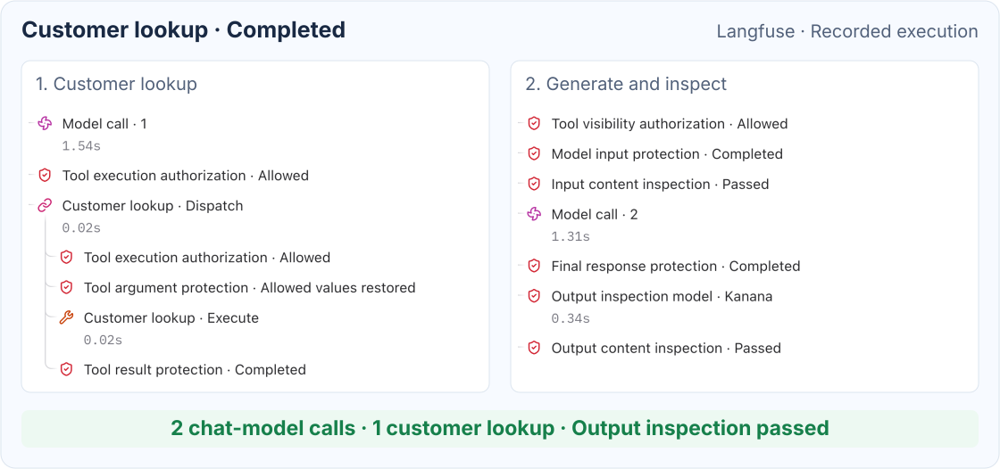
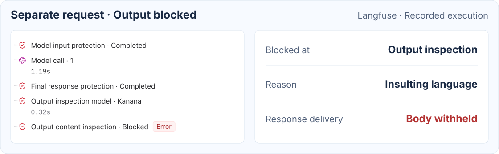

# Runtime Observation

**English** | [한국어](ko/observability.md)

Observers let an application record where privacy protection ran and what content inspection decided.

## A Completed Customer Lookup

The two columns show consecutive portions of one customer lookup request.

In this example, the application displays model/tool call records alongside Observer results in Langfuse.

1. The first model call requests a customer lookup. Tool authorization and privacy enforcement are recorded around that lookup.
2. The tool result is protected before the next model request. That request also passes input inspection.
3. The second model call generates the answer. Final-response protection and output inspection complete before delivery.

The two conversation-model calls and the output-inspection call are distinct.
The dispatch and execution rows refer to the same customer lookup, not two business operations.

## A Response Blocked After Generation

This is a separate request.
Input inspection passed, but output inspection detected insulting language in the reply and blocked its delivery.

The `Error` badge in this trace indicates that output inspection blocked response delivery.

[Final-output inspection](inspection.md#optional-final-output-inspection) must be enabled for this check.

## What the Library Reports

| Source | Available information | Example use |
| --- | --- | --- |
| `PrivacyEnforcementObserver` | Protection boundary and outcome | Count model-input protection, tool-input disclosure or output blocking events |
| `InspectionObserver` | Inspection phase, streaming flag, decision and inspector outcomes or failure | Count input/output decisions and inspect finding categories, codes and optional scores |

`PROTECTED` means the boundary processing completed. It does not establish that PII was detected or changed.
One request can emit multiple events, so an event count is not a request count.

## Connect the Observers

With the ChatClient Spring Boot starter, register a `PrivacyEnforcementObserver` bean and an `InspectionObserver` bean.
For explicit factory configuration, set `privacyObserver(...)` and `inspectionObserver(...)` on
`GuardrailsChatClientFactory.builder()`.

See the following guides for Observer registration examples:

- [Privacy runtime observation](privacy.md#privacy-safe-runtime-observation)
- [Inspection observability](inspection.md#observability)

The application configures the Langfuse integration, request correlation and duration measurement.
