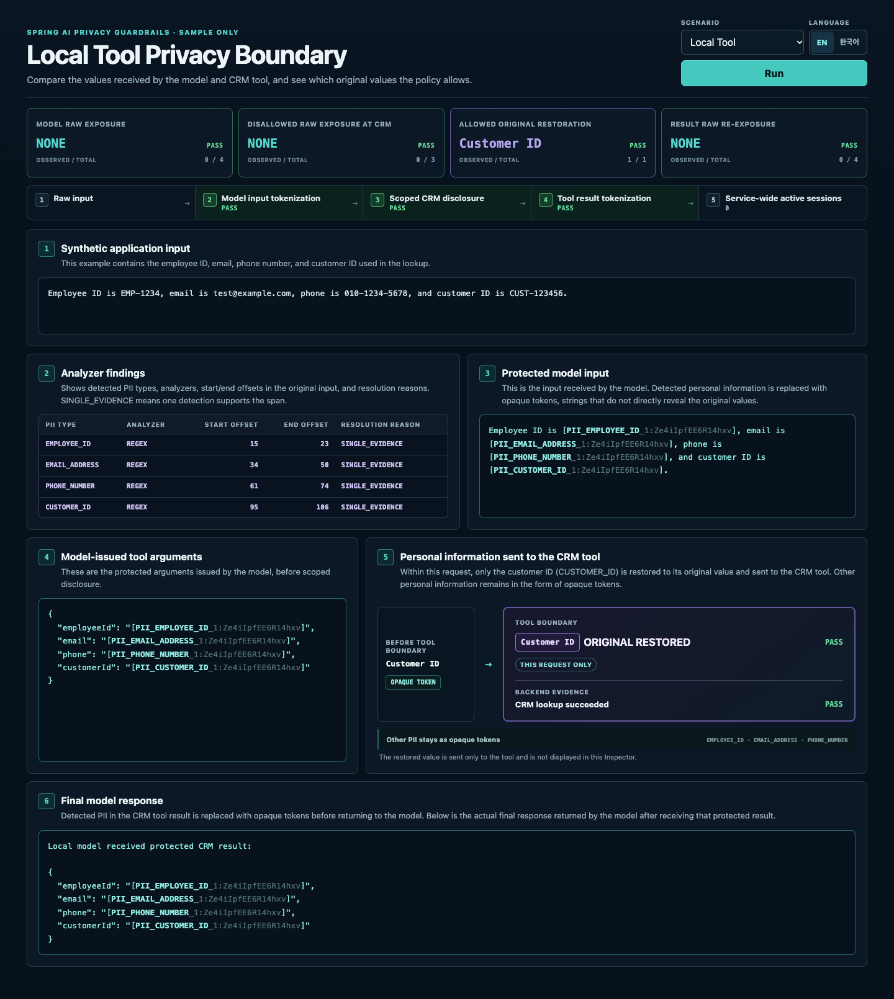
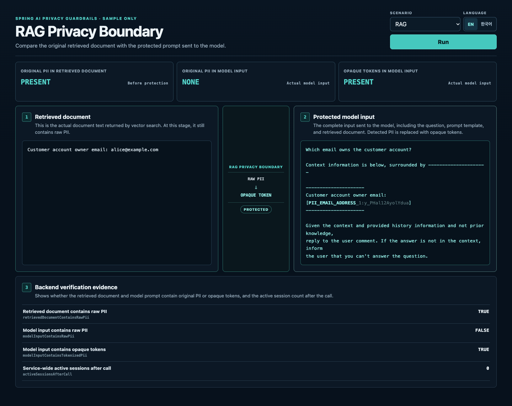
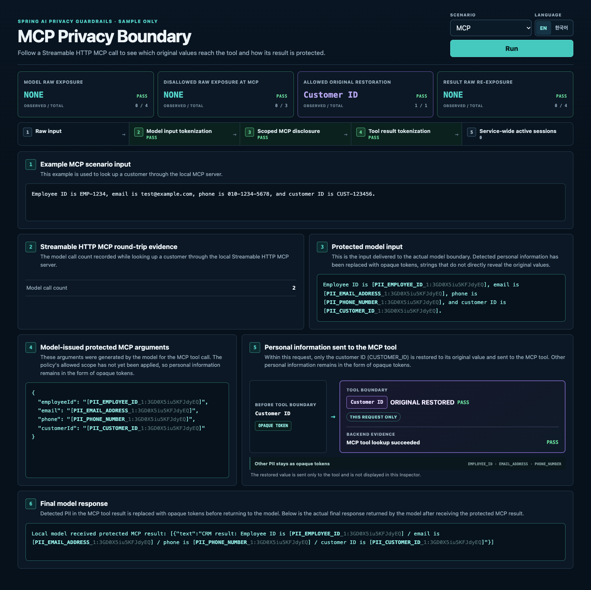

# Sample Guide

**English** | [한국어](ko/sample.md)

The sample uses fixed examples to show privacy protection, tool authorization and
content inspection. Its **Privacy Boundary Inspector** provides Local Tool, RAG,
MCP, Security and Inspection scenarios. The default configuration uses a local
scripted `ChatModel` and runs document retrieval and the MCP server locally.

## Run the Inspector

Install Git and JDK 17 or later. No external service accounts or API keys are required.
The first run needs network access to download Gradle and dependencies.

```bash
git clone https://github.com/ultramancode/spring-ai-privacy-guardrails.git
cd spring-ai-privacy-guardrails
git checkout v0.4.0
./gradlew :spring-ai-privacy-guardrails-sample-demo:run
```

After startup, open `http://127.0.0.1:8080`. The server accepts local connections only.

Choose a scenario in the Inspector. `EN | 한국어` changes the UI and fixed example language.

| Scenario | What to check | Apply it to your app |
| --- | --- | --- |
| Local Tool | Model tokenization, customer-ID-only disclosure, protected results | [Tool disclosure](privacy.md#per-tool-original-disclosure) |
| RAG | Original document versus the protected copy sent to the model | [Memory and RAG](configuration.md#advisor-configuration) |
| MCP | Protection on a local Streamable HTTP tool call | [MCP providers](privacy.md#per-tool-original-disclosure) |
| Security | Role-based tool visibility/execution and privacy on allowed calls | [Authorization setup](security.md) |
| Inspection | 0 model calls on blocked input, 1 call and withheld output on blocked output, passing cases | [Inspection setup](inspection.md) |

After the fixed examples, try your own synthetic input through the [input API](#inspect-results-through-the-api),
or choose analyzer and real-model profiles in the [full sample guide](https://github.com/ultramancode/spring-ai-privacy-guardrails/blob/v0.4.0/samples/spring-ai-demo/README.md).
See [Troubleshooting](troubleshooting.md) if results differ.

<div style="position: relative; width: 100%; aspect-ratio: 16 / 9;">
  <iframe
    src="https://www.youtube-nocookie.com/embed/IeeA5ogIX_I"
    title="Spring AI Privacy Guardrails English demo"
    style="position: absolute; inset: 0; width: 100%; height: 100%; border: 0;"
    loading="lazy"
    referrerpolicy="strict-origin-when-cross-origin"
    allow="accelerometer; autoplay; clipboard-write; encrypted-media; gyroscope; picture-in-picture; web-share"
    allowfullscreen>
  </iframe>
</div>

## What to Check in Each Scenario

### Local Tool

The sample replaces detected PII with opaque tokens, replacement strings
that do not directly reveal the original values. Select **Local Tool** and
check the values at each step:

1. **Model input and tool arguments:** The example's employee ID, email, phone
   number, and customer ID are replaced with opaque tokens. The model uses these opaque tokens
   in its tool arguments as well.
2. **Tool execution:** The CRM customer lookup tool receives only the original
   customer ID (`CUSTOMER_ID`) allowed by policy. The other three values remain
   opaque tokens.
3. **Tool result:** Detected PII in the result is replaced with opaque tokens
   before the result returns to the model.

The "Observed / total" counts at the top of the screen show how many of the
checked example values were found in their original form. For example, `0/4`
under "Model raw exposure" means none of the four originals were found at the
model. A count of `1/1` under "Allowed original restoration" means the permitted
customer ID was delivered in its original form. Each metric also shows `PASS`
or `FAIL`.



### RAG

Select **RAG** and compare the retrieved document with the prompt received by
the model. The document contains `alice@example.com`. In the model's prompt,
that email is replaced by an `EMAIL_ADDRESS` opaque token.

The screen displays the original retrieved document alongside the complete
protected prompt. The prompt includes the question, prompt template, and
retrieved context. The stored document is left unchanged.

The scenario retrieves documents using a local embedding model. It uses no
external vector store, embedding service, or LLM.



### MCP

Select **MCP** to run the `customerLookup` tool over Streamable HTTP. Check that
the tool receives only the original customer ID (`CUSTOMER_ID`), the other PII
values remain opaque tokens, and detected PII in the result is protected before
returning to the model.

The sample includes its own local MCP server, so no separately deployed MCP
service is needed.



### Security

Select **Security** to compare the same customer lookup request for two sample users:

- **General employee (`ROLE_EMPLOYEE`):** The model's tool list excludes
  `customerLookup`. Even if the model requests it, execution is denied and the
  tool runs zero times.
- **Customer support (`ROLE_CUSTOMER_SUPPORT`):** The model can see and call
  `customerLookup`. The tool runs once and receives only the customer ID
  (`CUSTOMER_ID`) in its original form. Detected PII in the result is replaced with
  opaque tokens before returning to the model.

The local model deliberately requests the lookup even when it is hidden, so the
scenario checks execution blocking as well as tool-list filtering. The sample
provides both users and their roles. No login or external authentication service
is needed. Tool access and permission to receive original PII are separate policies.


### Inspection

Select **Inspection** to compare **Blocked cases** and **Allowed cases**. Each
selection runs two independent requests. In blocked cases, input inspection stops
a prompt injection before the model is called (`0` calls), and output inspection
withholds an insulting response after the model is called (`1` call). Allowed
cases call the model once each and deliver a response. Changing the selected
case runs it automatically. Use **Run** to repeat the current selection.

Email addresses are tokenized before each inspection. The screen displays
actual reports, inspected text, and model call counts from the backend.

The local scripted `ChatModel` and literal inspection rules use fixed English
and Korean examples. They demonstrate enforcement without an external model
or API key. These rules do not provide general prompt attack or toxicity detection.


## Inspect Results Through the API

Use these APIs to retrieve the results shown in the Inspector as JSON:

| Endpoint | What it returns |
| --- | --- |
| `GET /demo/example-input` | Example input in the selected language. |
| `GET /demo/protect` | PII detection locations and tokenization results for the fixed example, without calling a model. |
| `POST /demo/protect` | PII detection locations and tokenization results for the JSON body's `text` field. The text must not be empty or contain only whitespace. |
| `GET /demo/tool-loop` | Model inputs, tool arguments, protected results, and per-stage checks (`boundaryEvidence`) from a CRM tool call. |
| `GET /demo/rag` | The original retrieved document (`retrievedDocument`) and the complete protected prompt received by the model (`modelInput`). |
| `GET /demo/mcp-tool-loop` | Model inputs, tool arguments, and results from a local Streamable HTTP MCP tool call. |
| `GET /demo/security-tool-boundary` | Tool visibility, authorization decisions, execution counts for two roles, and privacy checks for the allowed call. |
| `GET /demo/inspection?example=block` | Independent input/output block cases with actual inspection reports, model call counts, and withheld responses. Use `example=allow` for allowed cases. |

`activeSessionsAfterCall` is the service-wide active session count after the call.

See the [full sample guide](https://github.com/ultramancode/spring-ai-privacy-guardrails/blob/v0.4.0/samples/spring-ai-demo/README.md)
for request and response examples, configuration for other analyzers, and
instructions for running optional checks with a live model.

## Language Selection

Changing the Inspector's language changes the example input and results as
well as the UI labels. For direct API calls, set the `Accept-Language: en` or
`Accept-Language: ko` request header.

`POST /demo/protect` always analyzes the supplied `text`, regardless of the
selected language.

## Interpretation and Verification

The demo's employee and customer ID rules and all example values are sample-oriented. Text not
matched by an enabled analyzer may remain unchanged, and these fixed scenarios
do not establish general detection accuracy or prove protection for unsupported
execution paths.

For reproducible automated coverage, see the
[Privacy Boundary Verification Matrix](evaluation.md#privacy-boundary-verification-matrix).
